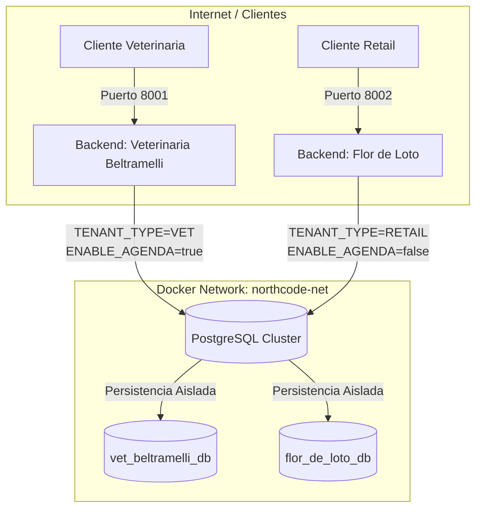

<!-- api-backend/README.md -->

> **Motor Central Agnóstico: Catálogo de Productos, Gestión de Pedidos, Facturación y Módulos de Dominio (Veterinaria / Retail / Servicios)**

El backend de **VetCore** está estructurado bajo una **Arquitectura en Capas Desacoplada** (Routers -> Schemas -> Services -> Repositories -> Models) sobre un modelo de infraestructura **Container-per-Tenant**. Un único código base (una sola imagen Docker) abastece a múltiples clientes y tipos de negocio (Clínicas Veterinarias, Tiendas de Ropa, Barberías) aislando datos a nivel de base de datos y activando funcionalidades mediante *Feature Flags*.

---

## 🛠 Tecnologías Principales

- 🚀 **[FastAPI](https://fastapi.tiangolo.com/)**: Framework asíncrono para contratos API estrictos.
- 🗄️ **[SQLAlchemy 2.0](https://docs.sqlalchemy.org/en/20/)**: Persistencia relacional orientada a objetos (Queries tipadas vía `select()`).
- 🛡️ **[Pydantic v2](https://docs.pydantic.dev/latest/)**: Validación estricta en tiempo de ejecución (`SettingsConfigDict`, `@field_validator`).
- ⚡ **[Uvicorn](https://www.uvicorn.org/)**: Servidor ASGI de alto rendimiento.
- 🐘 **[PostgreSQL 15](https://www.postgresql.org/docs/)**: Clúster de bases de datos relacionales independientes por tenant.
- 🔑 **[PyJWT / Passlib (Bcrypt)](https://passlib.readthedocs.io/)**: Autenticación RBAC y hashing seguro.
- 🐳 **[Docker & Compose V2](https://docs.docker.com/)**: Aislamiento, empaquetado multi-tenant y orquestación.

---

## 📦 Estructura del Proyecto

```text
api-backend/
├── Dockerfile                      # Imagen base de producción agnóstica
├── docker-compose.yml              # Orquestador del clúster de base de datos y contenedores backend
├── requirements.txt                # Dependencias fijadas con versiones exactas
├── run_desarrollo.py               # CLI runner para levantar entornos locales por tenant
├── .env.veterinaria                # Variables de entorno: Tenant Veterinaria Beltramelli
├── .env.flordeloto                 # Variables de entorno: Tenant Tienda Ropa Flor de Loto
├── init-scripts/
│   └── init-multi-db.sh            # Script bash para inicializar múltiples DBs en PostgreSQL
└── app/
    ├── __init__.py
    ├── main.py                     # Entrypoint: Inyección de middlewares y feature gating de routers
    ├── config.py                   # Pydantic Settings: parseo de variables y feature flags
    ├── database.py                 # Conexión SQLAlchemy, pool de sesiones y Base declarativa
    ├── security.py                 # Criptografía: Hashing bcrypt y encode/decode de JWT
    ├── models/                     # Entidades ORM (SQLAlchemy 2.0)
    │   ├── __init__.py
    │   ├── categoria_model.py
    │   ├── cliente_model.py
    │   ├── funcionario_model.py
    │   ├── imagen_url_model.py
    │   ├── pago_model.py
    │   ├── pedido_detalle_model.py # Invariante: Congelamiento de precio de venta
    │   ├── pedido_model.py
    │   ├── producto_model.py
    │   ├── producto_subcategoria_model.py # Relación N:M
    │   ├── subcategoria_model.py
    │   └── user_model.py
    ├── repositories/               # Capa de Persistencia (Queries puras)
    │   ├── __init__.py
    │   └── product_repo.py
    ├── router/                     # Controllers / Endpoints REST
    │   ├── __init__.py
    │   ├── auth_router.py
    │   ├── pedido_route.py
    │   ├── producto_router.py
    │   └── agenda_router.py        # Módulo cargado condicionalmente
    ├── schemas/                    # DTOs y Contratos de Entrada/Salida (Pydantic v2)
    │   ├── __init__.py
    │   ├── producto_schema.py
    │   └── user_schema.py
    ├── services/                   # Lógica de Negocio y Casos de Uso
    │   ├── __init__.py
    │   ├── import_excel.py         # Ingesta masiva de inventario
    │   ├── product_service.py
    │   ├── qr_generator.py         # Generación QR para validación de pedidos
    │   ├── token_service.py
    │   └── whatsapp_service.py     # Disparo de notificaciones
    └── static/                     # Assets persistidos localmente por tenant
        ├── veterinaria/
        └── flordeloto/
```

---

## 🏛 Arquitectura Multi-Tenant

El sistema implementa una separación **Database-per-Tenant** sobre una infraestructura compartida:



### Invariantes de Aislamiento:
1. **Agnosticismo de Código:** No existen forks de código ni repositorios paralelos. Todo cambio en el Core beneficia a todos los tenants.
2. **Feature Gating:** Módulos opcionales (ej. `Agenda`) no registran rutas en memoria si `ENABLE_AGENDA=false`.
3. **Snapshot Histórico:** `pedido_detalle.pd_precio_venta` almacena el valor monetario inmutable en el instante de la transacción, mitigando variaciones de precio en catálogo.

---

## 💻 Entorno de Desarrollo Local

### 1. Requisitos Previos
- Python 3.12+
- Motor Docker y Compose V2 activos
- Entorno virtual activado (`venv`)

### 2. Instalación de Dependencias
```bash
python3 -m venv venv
source venv/bin/activate  # En Windows: .\venv\Scripts\activate
pip install --upgrade pip
pip install -r requirements.txt
```

### 3. Ejecución por Tenant (Sin levantar contenedores de backend)
Asegúrate de tener el contenedor de PostgreSQL encendido y ejecuta el runner específico:

```bash
# Terminal 1: Backend Veterinaria (Puerto 8001)
python run_desarrollo.py veterinaria

# Terminal 2: Backend Flor de Loto (Puerto 8002)
python run_desarrollo.py flordeloto
```

---

## 🚀 Guía de Despliegue y Lanzamiento (Runbook de Producción)

Sigue este procedimiento operativo estándar para poner en marcha la infraestructura desde cero o agregar un nuevo cliente.

### Paso 1: Preparar la Infraestructura Base de Docker

El clúster requiere una red externa compartida y un volumen persistente que resista comandos destructivos de recreación:

```bash
# 1. Crear la red interna
docker network create northcode-net

# 2. Crear el volumen externo de datos para PostgreSQL
docker volume create postgres_cluster_data
```

### Paso 2: Configuración de Variables del Entorno

Asegúrate de que cada cliente tenga su archivo de configuración con credenciales y llaves criptográficas únicas:

- `.env.veterinaria`
- `.env.flordeloto`

> **Importante:** La variable `SECRET_KEY` de cada tenant debe ser generada de manera criptográfica e independiente:
> ```bash
> openssl rand -hex 32
> ```

### Paso 3: Inicialización del Clúster y Despliegue

Ejecuta el ciclo de construcción y levantamiento en segundo plano:

```bash
docker compose up -d --build
```

El script `init-scripts/init-multi-db.sh` se ejecutará automáticamente en el arranque inicial de PostgreSQL creando las bases de datos `vet_beltramelli_db` y `flor_de_loto_db` sin intervención manual.

### Paso 4: Carga y Siembra de Datos Iniciales (Seeders / Excel)

Para poblar el catálogo de un tenant específico mediante su archivo Excel:

<!-- <!> Esto no esta progrmador tengo que probarlo -->
```bash
# Para poblar Veterinaria Beltramelli
TENANT_ENV=.env.veterinaria python -m app.services.import_excel

# Para poblar Flor de Loto
TENANT_ENV=.env.flordeloto python -m app.services.import_excel
```

---

## ➕ Procedimiento para Agregar un Nuevo Cliente (Tenant)

Para incorporar un tercer comercio (ej. `Barbería Deluxe`):

1. **Crear su base de datos en el clúster:**
   - Agrega el nombre `barberia_deluxe_db` a la variable `POSTGRES_MULTIPLE_DATABASES` en `docker-compose.yml`.
2. **Crear su archivo de configuración:**
   - Duplica una plantilla como `.env.barberia` definiendo su propio `APP_PORT=8003`, `DB_NAME=barberia_deluxe_db` y sus llaves secretas.
3. **Declarar el servicio en `docker-compose.yml`:**
   ```yaml
   backend-barberia:
     build: .
     container_name: backend_barberia_deluxe
     restart: always
     ports:
       - "8003:8003"
     env_file:
       - .env.barberia
     depends_on:
       - postgres-cluster
     volumes:
       - ./app:/app/app
       - ./static/barberia:/app/static
     networks:
       - northcode-net
   ```
4. **Actualizar el runner local (`run_desarrollo.py`):**
   - Agrega `"barberia": ".env.barberia"` al diccionario `TENANTS`.
5. **Aplicar los cambios:**
   ```bash
   docker compose up -d --build backend-barberia
   ```

---

## 📖 Documentación de Endpoints por Tenant

Cada backend expone su propia documentación interactiva y OpenAPI Schema según sus módulos habilitados:

- **Veterinaria Beltramelli:** [http://localhost:8001/docs](http://localhost:8001/docs)
- **Flor de Loto:** [http://localhost:8002/docs](http://localhost:8002/docs)

---

## ⚠️ Diagnóstico y Resolución de Problemas

1. **Error: `database "<nombre>" does not exist` al arrancar el backend:**
   - El contenedor PostgreSQL ya se había inicializado antes de registrar la nueva base de datos en el script.
   - **Solución:** Entra al contenedor y créala manualmente sin destruir el volumen:
     ```bash
     docker exec -it vetcore_postgres_cluster psql -U ary -c "CREATE DATABASE nuevo_tenant_db;"
     ```

2. **Error CORS origin bloqueado al conectar el Frontend:**
   - Verifica el archivo `.env.<tenant>` del backend correspondiente y confirma que el puerto del frontend esté listado en `ALLOWED_ORIGINS`.

3. **Imágenes cruzadas entre tiendas:**
   - Revisa el mapeo de volúmenes en `docker-compose.yml`. Cada servicio backend debe apuntar a una subcarpeta estática aislada (`./static/<tenant>:/app/static`).