<!-- api-backend/docs/architecture/diagrama_arquitectura_backend.md -->

# 🏛️ Arquitectura del Sistema Multi-Tenant (VetCore / NorthCode)

Este diagrama representa la topología completa de red, el aislamiento de contenedores por tenant, la persistencia en el clúster unificado de PostgreSQL y el desacoplamiento de activos multimedia en Cloudflare R2.

```mermaid
graph TD
    %% ==========================================
    %% CAPA: CLIENTES Y FRONTENDS
    %% ==========================================
    subgraph layer_clients ["🌐 Capa de Clientes / Frontends Web (Vite + Nginx)"]
        F1["Frontend: Veterinaria Beltramelli<br/><code>veterinaria-beltramelli.com</code>"]
        F2["Frontend: Vestimenta Flor de Loto<br/><code>flordeloto-moda.northcode-uy.com</code>"]
        FN["Frontend: Tenant N - Escalabilidad<br/><code>cliente-n.com</code>"]
    end

    %% ==========================================
    %% CAPA: DOCKER NETWORK (AISLAMIENTO PRIVADO)
    %% ==========================================
    subgraph docker_network ["🐳 Red Privada Docker: northcode-net"]

        %% Contenedores Backend Independientes
        subgraph backend_containers ["🚀 Contenedores Backend - FastAPI / Mismo Artefacto Docker"]
            BV["Container: backend_vet_beltramelli<br/><b>Puerto Host: 8001</b><br/>TENANT_TYPE=VET | AGENDA=true"]
            BF["Container: backend_vestimenta_flordeloto<br/><b>Puerto Host: 8002</b><br/>TENANT_TYPE=RETAIL | AGENDA=false"]
            BN["Container: backend_tenant_n<br/><b>Puerto Host: 800X</b><br/>Configuracion Dinamica"]
        end

        %% Contenedor Unico de Base de Datos
        subgraph db_container ["🐘 Cluster PostgreSQL 15 - vet_db_bel:5432"]
            PG_ENGINE[("Motor PostgreSQL Server")]

            subgraph isolated_databases ["Bases de Datos Logicas Aisladas"]
                DB1[("vet_beltramelli_db<br/>Dueno: usr_veterinaria")]
                DB2[("flor_de_loto_db<br/>Dueno: usr_flordeloto")]
                DBN[("tenant_n_db<br/>Dueno: usr_tenant_n")]
            end

            PG_ENGINE --- DB1
            PG_ENGINE --- DB2
            PG_ENGINE --- DBN
        end
    end

    %% ==========================================
    %% CAPA: ALMACENAMIENTO DE OBJETOS EXTERNO
    %% ==========================================
    subgraph cloudflare_r2 ["☁️ Almacenamiento de Objetos: Cloudflare R2 - Stateless"]
        R2_1[("Bucket: vetcore-media<br/>media.veterinaria-beltramelli.com")]
        R2_2[("Bucket: flordeloto-media<br/>media.flordeloto.com")]
        R2_N[("Bucket: tenant-n-media<br/>media.tenant-n.com")]
    end

    %% ==========================================
    %% FLUJO DE CONEXIONES Y DEPENDENCIAS
    %% ==========================================
    F1 -->|HTTP Proxy / REST| BV
    F2 -->|HTTP Proxy / REST| BF
    FN -->|HTTP Proxy / REST| BN

    BV -->|Conexion Aislada| DB1
    BF -->|Conexion Aislada| DB2
    BN -->|Conexion Aislada| DBN

    BV -.->|S3 API Boto3| R2_1
    BF -.->|S3 API Boto3| R2_2
    BN -.->|S3 API Boto3| R2_N

    %% ==========================================
    %% ESTILOS VISUALES
    %% ==========================================
    classDef clientStyle fill:#0f172a,stroke:#38bdf8,stroke-width:2px,color:#fff;
    classDef backendStyle fill:#1e293b,stroke:#3b82f6,stroke-width:2px,color:#fff;
    classDef dbStyle fill:#064e3b,stroke:#10b981,stroke-width:2px,color:#fff;
    classDef r2Style fill:#431407,stroke:#f97316,stroke-width:2px,color:#fff;

    class F1,F2,FN clientStyle;
    class BV,BF,BN backendStyle;
    class PG_ENGINE,DB1,DB2,DBN dbStyle;
    class R2_1,R2_2,R2_N r2Style;
```

