<!-- api-backend/docs/architecture/diagrama_base_de_datos.md -->

# 🗄️ Diagrama de Base de Datos — VetCore / NorthCode

Diagrama Entidad-Relación que refleja el esquema real de PostgreSQL generado por SQLAlchemy, basado en los modelos actuales del proyecto.

```mermaid
erDiagram

    %% ============================================================
    %% IDENTIDAD Y ACCESO
    %% ============================================================
    usuarios {
        int     usu_id          PK
        string  usu_email       "UNIQUE NOT NULL"
        string  usu_password_hash "NOT NULL (Bcrypt)"
        string  usu_nombre      "NOT NULL"
        string  usu_nombre_mostrar
        string  usu_whatsapp    "UNIQUE"
        string  usu_rol         "ADMIN | FUNCIONARIO | CLIENTE"
        bool    usu_activo      "Baja logica"
        string  usu_imagen_url
        string  usu_direccion
        string  usu_ubicacion   "GPS: lat, lon"
    }

    clientes {
        int     cli_id          PK "FK -> usuarios.usu_id"
        float   cli_deuda       "default 0.0"
    }

    funcionarios {
        int     fun_id          PK "FK -> usuarios.usu_id (CASCADE)"
        string  fun_cargo       "Veterinario | Cajero | Peluquero"
        string  fun_matricula   "Matricula profesional (opcional)"
    }

    %% ============================================================
    %% CATALOGO DE PRODUCTOS
    %% ============================================================
    categoria {
        int     cat_id          PK
        string  cat_nombre      "UNIQUE NOT NULL"
    }

    subcategoria {
        int     subc_id         PK
        string  subc_nombre     "UNIQUE NOT NULL"
        string  subc_icono      "Nombre icono Lucide/FontAwesome"
        string  subc_imagen_url "URL CDN/R2 (opcional)"
    }

    producto {
        int     prod_id         PK
        string  prod_nombre     "NOT NULL max 150"
        string  prod_descripcion
        float   prod_precio     "NOT NULL default 0.0"
        int     prod_stock      "Stock global (fallback sin variantes)"
        string  codigo_barra    "UNIQUE EAN/UPC (opcional)"
        bool    prod_activo     "Baja logica"
        bool    prod_disponible "Disponible para venta"
        bool    prod_visible    "Visible en vitrina publica"
        bool    permitir_sin_stock "Habilita backorders"
        int     cat_id          "FK -> categoria.cat_id"
    }

    producto_subcategoria {
        int     prod_id         PK "FK -> producto.prod_id"
        int     subc_id         PK "FK -> subcategoria.subc_id"
    }

    color {
        int     col_id          PK
        string  col_nombre      "UNIQUE NOT NULL"
        string  col_hex         "Codigo HEX: #RRGGBB"
    }

    producto_variante {
        int     var_id          PK
        int     prod_id         "FK -> producto.prod_id (CASCADE)"
        int     col_id          "FK -> color.col_id (opcional)"
        string  var_tipo        "Talle | Volumen | Peso | Medida"
        string  var_nombre      "S | XL | 250ml | 5Kg"
        string  sku             "UNIQUE (opcional)"
        float   var_precio_adicional "Diferencial sobre precio base"
        int     var_stock       "Stock exclusivo de esta variante"
    }

    imagen_url {
        int     img_id          PK
        int     prod_id         "FK -> producto.prod_id (CASCADE)"
        string  img_url         "Ruta local /static/... o URL CDN"
        bool    img_principal   "Imagen destacada en tarjeta"
        string  img_tipo        "producto | banner | usuario"
    }

    %% ============================================================
    %% PEDIDOS Y PAGOS
    %% ============================================================
    pedido {
        int      ped_id         PK
        int      cli_id         "FK -> clientes.cli_id"
        datetime ped_fecha_emision
        string   ped_codigo_qr
        string   ped_direccion
        string   ped_estado     "PENDIENTE | CONFIRMADO | ENTREGADO"
        float    ped_total
        bool     ped_pagado
    }

    pedido_detalle {
        int     det_id          PK
        int     ped_id          "FK -> pedido.ped_id (CASCADE)"
        int     prod_id         "FK -> producto.prod_id"
        int     var_id          "FK -> producto_variante.var_id (SET NULL, opcional)"
        int     pd_cantidad     "default 1"
        float   pd_precio       "Snapshot precio al momento del checkout"
    }

    pago {
        int      pago_id        PK
        int      ped_id         "FK -> pedido.ped_id NOT NULL"
        float    pago_monto     "NOT NULL"
        datetime pago_fecha     "NOT NULL"
        string   pago_metodo    "Efectivo | Transferencia | MP"
        string   pago_referencia
    }

    %% ============================================================
    %% LOGISTICA: CAJAS DE DEPOSITO
    %% ============================================================
    caja {
        int      caja_id        PK
        string   caja_codigo    "UNIQUE - genera QR"
        string   caja_nombre    "Etiqueta descriptiva"
        string   direccion      "Ubicacion fisica"
        string   deposito_referencia
        string   contacto_nombre
        string   contacto_telefono
        string   estado         "DISPONIBLE | EN_TRANSITO | LLENA"
        datetime created_at
    }

    caja_item {
        int     item_id         PK
        int     caja_id         "FK -> caja.caja_id (CASCADE)"
        int     prod_id         "FK -> producto.prod_id"
        int     var_id          "FK -> producto_variante.var_id (opcional)"
        int     cantidad        "default 1"
    }

    %% ============================================================
    %% RELACIONES
    %% ============================================================

    %% Identidad
    usuarios    ||--o| clientes       : "extiende 1:1"
    usuarios    ||--o| funcionarios   : "extiende 1:1"

    %% Catalogo
    categoria   ||--o{ producto       : "clasifica"
    producto    ||--o{ producto_subcategoria : "categoriza"
    subcategoria||--o{ producto_subcategoria : "agrupa"
    producto    ||--o{ producto_variante    : "tiene variantes"
    color       ||--o{ producto_variante    : "colorea"
    producto    ||--o{ imagen_url           : "tiene imagenes"

    %% Pedidos
    clientes    ||--o{ pedido         : "realiza"
    pedido      ||--o{ pedido_detalle : "contiene lineas"
    producto    ||--o{ pedido_detalle : "incluido en"
    producto_variante ||--o{ pedido_detalle : "variante vendida"
    pedido      ||--o{ pago           : "tiene pagos"

    %% Logistica
    caja        ||--o{ caja_item      : "almacena items"
    producto    ||--o{ caja_item      : "guardado en"
    producto_variante ||--o{ caja_item : "variante guardada"
```

---

## 📋 Resumen de Tablas

| Tabla | Descripcion | Filas clave |
|---|---|---|
| `usuarios` | Identidad y autenticacion RBAC | `usu_id`, `usu_rol`, `usu_activo` |
| `clientes` | Extension 1:1 de usuario comprador | `cli_id → usu_id`, `cli_deuda` |
| `funcionarios` | Extension 1:1 de usuario empleado | `fun_id → usu_id`, `fun_cargo` |
| `categoria` | Clasificacion principal del catalogo | `cat_id`, `cat_nombre` |
| `subcategoria` | Clasificacion secundaria con iconos | `subc_id`, `subc_icono` |
| `producto_subcategoria` | Tabla pivote M:N producto↔subcategoria | `prod_id + subc_id` PK compuesta |
| `producto` | Entidad maestra del catalogo | `prod_id`, `prod_precio`, `prod_stock` |
| `color` | Paleta de colores normalizada | `col_id`, `col_hex` |
| `producto_variante` | SKU fisico vendible (talle/volumen/color) | `var_id`, `var_stock`, `var_precio_adicional` |
| `imagen_url` | Galeria multimedia por producto | `img_id`, `img_principal` |
| `pedido` | Cabecera transaccional de compra | `ped_id`, `ped_estado`, `ped_total` |
| `pedido_detalle` | Linea de pedido con snapshot de precio | `det_id`, `pd_precio` (congelado) |
| `pago` | Registro de transacciones de cobro | `pago_id`, `pago_metodo` |
| `caja` | Contenedor fisico de deposito | `caja_id`, `caja_codigo` (QR) |
| `caja_item` | Producto/variante asignado a una caja | `item_id`, `cantidad` |
