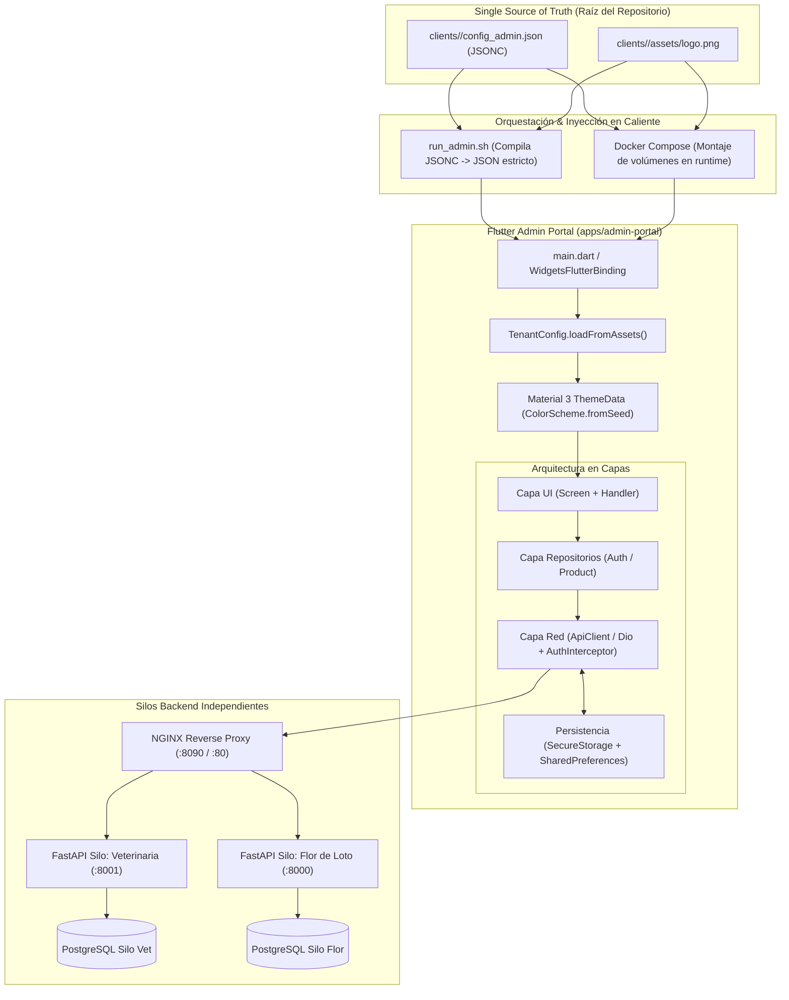
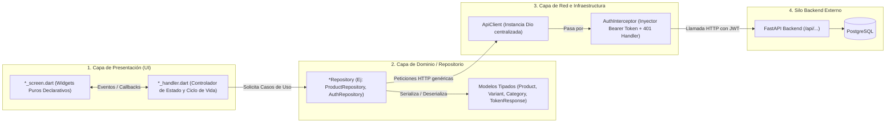
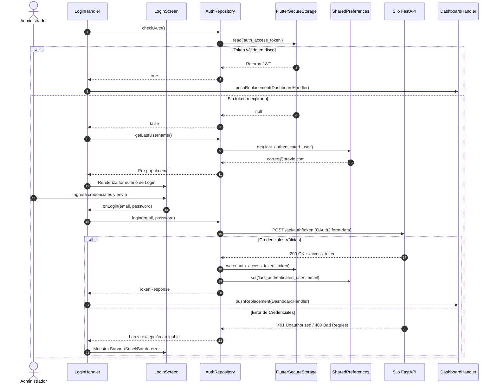

<!-- apps/admin-portal/README.md -->

# 🏢 VetCore Admin Portal (`apps/admin-portal`)

Suite administrativa multiplataforma (**Web, Linux Desktop y Mobile**) para la plataforma SaaS **VetCore**. Desarrollada con **[Flutter](https://flutter.dev)** (Dart 3) bajo los principios de **Clean Architecture**, separación estricta **Screen + Handler**, modularización **Feature-First** y **Aislamiento Multi-Tenant en Silos (Zero Hardcoding)**.

Permite a los administradores de cada comercio gestionar de forma reactiva su vitrina digital, catálogo de productos, control de stock, variantes físicas (SKUs), cálculo automático de márgenes financieros y parametrización operativa en tiempo real contra su propio silo backend de FastAPI.

---

## 🏛️ Arquitectura del Sistema

La arquitectura está diseñada para desacoplar completamente el código fuente de cualquier dato específico del cliente (branding, colores, módulos habilitados o URLs de backend).

### 1. Visión General Multi-Tenant y Aislamiento en Silos



---

### 2. Flujo de Datos Arquitectónico por Capas

El portal implementa una separación estricta de responsabilidades en 4 capas desacopladas:



---

### 3. Ciclo de Autenticación y Restauración de Sesión



---

## 💡 Principios Arquitectónicos Clave

1. **Zero Hardcoding (100% Agnóstico):**
   - No existen nombres de marcas, títulos fijos, URLs base o códigos de color hexadecimales cableados en los widgets.
   - Toda la identidad cromática se genera en tiempo de ejecución a través del árbol de contexto mediante `Theme.of(context).colorScheme` y [Material 3 Dynamic Theming](https://docs.flutter.dev/ui/design/material).
2. **Single Source of Truth (`clients/`):**
   - La identidad visual, los módulos operativos activos (`admin_modules`) y las reglas de negocio provienen exclusivamente del archivo `clients/<tenant>/config_admin.json` y los assets institucionales del cliente.
3. **Resolución de Red Desacoplada:**
   - La aplicación no asume un host fijo:
     - En **Desarrollo Local**: Consume la variable de entorno `--dart-define=API_URL="http://localhost:PORT"`.
     - En **Web Producción (Docker)**: La URL base se resuelve como ruta relativa vacía `""`, permitiendo que el tráfico `/api/` sea delegado al proxy inverso de NGINX hacia el nombre de contenedor del backend en la red compartida `northcode-net`.
4. **Patrón Screen + Handler:**
   - `*_screen.dart`: Widgets declarativos e inmutables (`StatelessWidget`). No realizan llamadas directas a APIs ni instancian repositorios; reciben datos y disparan callbacks.
   - `*_handler.dart`: Controladores con estado mutable (`StatefulWidget`). Administran controladores de texto (`TextEditingController`), ciclo de vida (`initState`, `dispose`), validación de formularios y orquestación con la capa de repositorios.
5. **Persistencia Híbrida de Sesión:**
   - [FlutterSecureStorage](https://pub.dev/packages/flutter_secure_storage): Cifra en almacenamiento nativo seguro (KeyStore en Android, Keychain en iOS/macOS, Web Crypto API en Web) el Bearer JWT.
   - [SharedPreferences](https://pub.dev/packages/shared_preferences): Almacena metadatos no sensibles como el último correo autenticado para habilitar autocompletado y acelerar el reingreso.

---

## 📂 Estructura de Directorios del Portal

Estructura modular del proyecto en [apps/admin-portal/](file:///home/ary/Documentos/proyect/app/vet-core/apps/admin-portal):


## 📂 Mapa Arquitectónico del Proyecto

Haga clic en cualquier enlace para inspeccionar el archivo o módulo correspondiente:


Aquí tienes el bloque formateado exactamente bajo el estándar de **listas no ordenadas anidadas de Markdown con hipervínculos relativos y comentarios técnicos en cursiva**, perfectamente homologado con el formato de tu `web-client`:

---

<!-- <!> agregar al arbol // apps/admin-portal/lib/services/pwa/pwa_service.dart -->


* 📁 **[clients/](../../clients/)** *(Silos de configuración y assets por cliente)*
  * 📁 **[veterinariabeltrameli/](../../clients/veterinariabeltrameli/)** *(Cliente Veterinaria con backend activo)*
    * 📁 **[assets/](../../clients/veterinariabeltrameli/assets/)** *(Isotipo oficial y recursos gráficos)*
    * 📄 [config_admin.json](../../clients/veterinariabeltrameli/config_admin.json) *(Configuración operativa del panel y temas)*
    * 📄 [config.json](../../clients/veterinariabeltrameli/config.json) *(Configuración de la tienda pública React)*
  * 📁 **[_template/](../../clients/_template/)** *(Plantilla agnóstica para clonar nuevos comercios)*
    * 📁 **[assets/](../../clients/_template/assets/)** *(Placeholders de logotipos e isotipos)*
    * 📄 [config_admin.json](../../clients/_template/config_admin.json) *(Esquema maestro de administración)*
* 📁 **apps/admin-portal/** *(Código fuente Portal Administrativo Flutter)*
  * 📄 [Dockerfile](Dockerfile) *(Compilación multi-stage: Flutter Web -> NGINX Alpine)*
  * 📄 [docker-compose.yml](docker-compose.yml) *(Orquestador multi-contenedor con red northcode-net)*
  * 📄 [nginx.conf.template](nginx.conf.template) *(Plantilla NGINX con proxy dinámico ${BACKEND_HOST} y SPA routing)*
  * 📄 [pubspec.yaml](pubspec.yaml) *(Manifiesto de dependencias Dart 3 y assets del tenant)*
  * 📄 [run_admin.sh](run_admin.sh) *(Orquestador CLI local para resolución de puertos y hot-reload)*
  * 📄 [README.md](README.md) *(Documentación técnica centralizada del módulo)*
  * 📁 **[assets/](assets/)**
    * 📁 **[tenant/](assets/tenant/)** *(Inyección en caliente del comercio activo en runtime)*
      * 📄 [config.json](assets/tenant/config.json) *(JSON estricto sanitizado sin comentarios //)*
      * 🖼️ [logo.png](assets/tenant/logo.png) *(Logotipo oficial del comercio activo)*
  * 📁 **[lib/](lib/)**
    * 🚀 [main.dart](lib/main.dart) *(Bootstrap: Inicialización, carga de TenantConfig y Auto-Login)*
    * 📁 **[config/](lib/config/)** *(Infraestructura runtime y personalización agnóstica)*
      * 📄 [app_colors.dart](lib/config/app_colors.dart) *(Tokens semánticos de color y fallbacks seguros)*
      * 📄 [app_environment.dart](lib/config/app_environment.dart) *(Captura de variables --dart-define y endpoints relativos)*
      * 📄 [app_theme.dart](lib/config/app_theme.dart) *(Generador dinámico de ThemeData en Material 3)*
      * 📄 [tenant_config.dart](lib/config/tenant_config.dart) *(Parser tipado con sanitizador JSONC en memoria)*
    * 📁 **[models/](lib/models/)** *(Entidades de dominio inmutables Pydantic <-> Dart)*
      * 📄 [auth_models.dart](lib/models/auth_models.dart) *(Credenciales de acceso, TokenResponse y sesión JWT)*
      * 📁 **[product/](lib/models/product/)** *(Subdominio desacoplado de catálogo - Principio SRP)*
        * 📄 [product.dart](lib/models/product/product.dart) *(Barrel export unificado de catálogo)*
        * 📄 [product_model.dart](lib/models/product/product_model.dart) *(Entidad maestra de producto y reglas de stock)*
        * 📄 [product_variant_model.dart](lib/models/product/product_variant_model.dart) *(SKUs, talles/pesos, stock y precios)*
        * 📄 [product_image_model.dart](lib/models/product/product_image_model.dart) *(Galería multimedia y marcado de portada)*
        * 📄 [category_model.dart](lib/models/product/category_model.dart) *(Clasificación primaria del producto)*
        * 📄 [subcategory_model.dart](lib/models/product/subcategory_model.dart) *(Clasificación secundaria y etiquetas)*
        * 📄 [color_model.dart](lib/models/product/color_model.dart) *(Modelo de color hexadecimal para variantes)*
    * 📁 **[network/](lib/network/)** *(Infraestructura HTTP y comunicación REST)*
      * 📄 [api_client.dart](lib/network/api_client.dart) *(Cliente Dio centralizado con timeouts, base URL y logging)*
      * 📄 [api_endpoints.dart](lib/network/api_endpoints.dart) *(Catálogo centralizado de rutas del backend FastAPI)*
      * 📁 **[interceptors/](lib/network/interceptors/)**
        * 📄 [auth_interceptor.dart](lib/network/interceptors/auth_interceptor.dart) *(Inyector automático de Bearer Token y captura de 401)*
    * 📁 **[repositories/](lib/repositories/)** *(Capa de datos y casos de uso - Patrón Repository)*
      * 📄 [auth_repository.dart](lib/repositories/auth_repository.dart) *(Login OAuth2, logout y persistencia segura de sesión)*
      * 📄 [product_repository.dart](lib/repositories/product_repository.dart) *(Consumo de /api/productos/admin_todos y toggles)*
    * 📁 **[screens/](lib/screens/)** *(Vistas y controladores de estado - Patrón Screen + Handler)*
      * 📄 [login_screen.dart](lib/screens/login_screen.dart) *(UI pura del formulario de autenticación)*
      * 📄 [login_handler.dart](lib/screens/login_handler.dart) *(Controlador de sesión, estado de carga y JWT)*
      * 📄 [dashboard_screen.dart](lib/screens/dashboard_screen.dart) *(Layout contenedor: TopBar + Body + BottomBar)*
      * 📄 [dashboard_handler.dart](lib/screens/dashboard_handler.dart) *(Navegación indexada con IndexedStack persistente)*
      * 📄 [catalog_screen.dart](lib/screens/catalog_screen.dart) *(Vista declarativa con listado de productos y filtros)*
      * 📄 [catalog_handler.dart](lib/screens/catalog_handler.dart) *(Controlador reactivo de inventario y mutaciones)*


<!-- <!> Bueno vamos a altera esot  -->
      * 📁 **[product_form/](lib/screens/product_form/)** *(Módulo de Alta y Edición de Producto)*
        * 📄 [product_form_screen.dart](lib/screens/product_form/product_form_screen.dart) *(Formulario maestro que ensambla las 6 secciones)*
        * 📄 [product_form_handler.dart](lib/screens/product_form/product_form_handler.dart) *(Cálculo de margen, validación y despacho HTTP)*
        * 📁 **[widgets/](lib/screens/product_form/widgets/)** *(Subsecciones atómicas del formulario)*
  


          * 📄 [form_section_card.dart](lib/screens/product_form/widgets/form_section_card.dart) *(Tarjeta estilizada contenedora reutilizable <!> croe qeu esto eria el titulo de arriba meror este cometario para saber )*
          * 📄 [basic_info_section.dart](lib/screens/product_form/widgets/basic_info_section.dart) *(Sección 1: Nombre, categoría, tags y EAN)*
          * 📄 [gallery_picker_section.dart](lib/screens/product_form/widgets/gallery_picker_section.dart) *(Sección 2: Portada y selector de fotografías)*
          * 📄 [pricing_finance_section.dart](lib/screens/product_form/widgets/pricing_finance_section.dart) *(Sección 3: Precio PVP, costo y margen reactivo)*
          * 📄 [inventory_stock_section.dart](lib/screens/product_form/widgets/inventory_stock_section.dart) *(Sección 4: Stock actual y punto de pedido)*
          * 📄 [showcase_switches_section.dart](lib/screens/product_form/widgets/showcase_switches_section.dart) *(Sección 5: Banderas booleanas de vitrina)*
          * 📄 [variants_editor_section.dart](lib/screens/product_form/widgets/variants_editor_section.dart) *(Sección 6: Editor dinámico de SKUs y variantes)*


    * 📁 **[services/](lib/services/)** *(Servicios transversales de aplicación)*
      * 📄 [auth_service.dart](lib/services/auth_service.dart) *(Servicio auxiliar de autenticación)*
    * 📁 **[widgets/](lib/widgets/)** *(Componentes visuales transversales reutilizables)*
      * 📄 [dashboard_top_bar.dart](lib/widgets/dashboard_top_bar.dart) *(Barra superior con imagotipo, título y menú de perfil)*
      * 📄 [dashboard_bottom_bar.dart](lib/widgets/dashboard_bottom_bar.dart) *(Barra inferior fija táctil: Inventario, Alta, Cajas)*
      * 📄 [metrics_header.dart](lib/widgets/metrics_header.dart) *(KPIs de inventario: Total, En Vitrina, Críticos, Pausados)*
      * 📄 [product_card_item.dart](lib/widgets/product_card_item.dart) *(Tarjeta de producto con carrusel, badges y acciones)*
      * 📄 [search_and_filters.dart](lib/widgets/search_and_filters.dart) *(Buscador en tiempo real y chips de segmentación)*


---

## 🛠️ Módulos Funcionales Desarrollados

### 1. Autenticación y Recuperación de Sesión
- Archivos clave: [login_handler.dart](file:///home/ary/Documentos/proyect/app/vet-core/apps/admin-portal/lib/screens/login_handler.dart), [login_screen.dart](file:///home/ary/Documentos/proyect/app/vet-core/apps/admin-portal/lib/screens/login_screen.dart) y [auth_repository.dart](file:///home/ary/Documentos/proyect/app/vet-core/apps/admin-portal/lib/repositories/auth_repository.dart).
- Cumple con el estándar **OAuth2 Password Grant** enviando `username` y `password` al endpoint `/api/auth/token`.
- Restaura la sesión automáticamente al iniciar la app sin parpadeos visuales si el token persiste en el almacenamiento seguro.
- Auto-rellena el último usuario recordado mediante `SharedPreferences`.

### 2. Shell Administrativo y Navegación
- Archivos clave: [dashboard_handler.dart](file:///home/ary/Documentos/proyect/app/vet-core/apps/admin-portal/lib/screens/dashboard_handler.dart) y [dashboard_screen.dart](file:///home/ary/Documentos/proyect/app/vet-core/apps/admin-portal/lib/screens/dashboard_screen.dart).
- Preservación de estado mediante `IndexedStack`: al alternar entre el catálogo y el formulario de alta, los datos cargados y la posición de scroll no se pierden.
- Barras de interfaz semánticas: [dashboard_top_bar.dart](file:///home/ary/Documentos/proyect/app/vet-core/apps/admin-portal/lib/widgets/dashboard_top_bar.dart) y [dashboard_bottom_bar.dart](file:///home/ary/Documentos/proyect/app/vet-core/apps/admin-portal/lib/widgets/dashboard_bottom_bar.dart).

### 3. Catálogo y Vitrina Comercial
- Archivos clave: [catalog_handler.dart](file:///home/ary/Documentos/proyect/app/vet-core/apps/admin-portal/lib/screens/catalog_handler.dart), [catalog_screen.dart](file:///home/ary/Documentos/proyect/app/vet-core/apps/admin-portal/lib/screens/catalog_screen.dart) y [product_card_item.dart](file:///home/ary/Documentos/proyect/app/vet-core/apps/admin-portal/lib/widgets/product_card_item.dart).
- Métricas en tiempo real con [metrics_header.dart](file:///home/ary/Documentos/proyect/app/vet-core/apps/admin-portal/lib/widgets/metrics_header.dart): Total de ítems, productos en vitrina activa, productos con stock crítico y productos pausados.
- Búsqueda en tiempo real por nombre, SKU o código de barras, complementada con chips de filtro de estado.
- Tarjeta de producto de alta densidad informativa:
  - Mini-carrusel de imágenes con contador y puntos indicadores.
  - Badges de alerta de stock crítico (`stock <= stock_minimo`).
  - Interruptor directo de vitrina con efecto de atenuación visual (`AnimatedOpacity`).
  - Desglose de variantes físicas con sus respectivos precios y stock.
  - Acciones rápidas: pausar compra, editar producto y baja lógica.

### 4. Formulario Maestro de Alta y Edición de Producto
- Archivos clave: [product_form_handler.dart](file:///home/ary/Documentos/proyect/app/vet-core/apps/admin-portal/lib/screens/product_form/product_form_handler.dart) y [product_form_screen.dart](file:///home/ary/Documentos/proyect/app/vet-core/apps/admin-portal/lib/screens/product_form/product_form_screen.dart).
- Dividido en 6 secciones modulares e independientes:
  1. **Información Básica:** Nombre, taxonomía (categorías/subcategorías), tags de segmentación y código EAN/barra.
  2. **Galería Multimedia:** Carga de URLs de imágenes, selección de imagen destacada y previsualización.
  3. **Precios y Finanzas:** Precio al público (PVP), costo unitario y cálculo reactivo en tiempo real del porcentaje de margen de ganancia:
     $$\text{Margen (\%)} = \frac{\text{PVP} - \text{Costo}}{\text{PVP}} \times 100$$
  4. **Inventario:** Stock actual y punto de pedido (stock mínimo crítico).
  5. **Banderas de Vitrina:** Switches de visibilidad pública, disponibilidad inmediata, modo exclusivo de variantes y soporte de pedidos diferidos (backorders).
  6. **Editor de Variantes:** Gestión dinámica de combinaciones físicas (talles, pesos, colores, precios y stock específico por variante).

---

## 🔑 Credenciales de Acceso en Entorno Local

Datos preconfigurados en la base de datos PostgreSQL del silo veterinario:

| Parámetro | Valor de Desarrollo |
| :--- | :--- |
| **Usuario / Correo** | `admin@beltramelli.com` |
| **Contraseña** | `654321` |
| **Host FastAPI Local** | `http://localhost:8001` |
| **Endpoint Token** | `POST /api/auth/token` |

---

## 🚀 Guía de Ejecución y Desarrollo Local

### Opción A: Orquestador Automatizado (`run_admin.sh`) *(Recomendado)*

El script [run_admin.sh](file:///home/ary/Documentos/proyect/app/vet-core/apps/admin-portal/run_admin.sh) automatiza todas las tareas operativas previas:
1. Resuelve dinámicamente las rutas del cliente (`clients/` o `clientes/`).
2. Normaliza y compila el archivo `config_admin.json` (que permite comentarios JSONC) a un archivo `assets/tenant/config.json` válido para Flutter mediante un parser Python integrado.
3. Asigna permisos `0644` de forma atómica para prevenir errores `403 Forbidden` al ser servido por servidores web.
4. Extrae automáticamente el puerto del backend desde el archivo `.env.<tenant>` del backend.
5. Inyecta flags de optimización como `--no-pub` cuando las dependencias están resueltas.

Ejecutar en **Linux Desktop** (modo más rápido para desarrollo):
```bash
./run_admin.sh veterinaria linux
```


Ejecutar en **Google Chrome** (Flutter Web):
```bash
./run_admin.sh veterinaria chrome
```

Ejecutar en **Web Server** (puerto estático `:5050`):
```bash
./run_admin.sh veterinaria web-server
```

> [!TIP]
> Puedes cambiar de tenant pasando su identificador como primer parámetro:
> `./run_admin.sh flordeloto linux`

---

### Opción B: Ejecución Manual Paso a Paso

#### 1. Iniciar el Backend FastAPI del Tenant
Desde el directorio del backend:
```bash
cd api-backend
python run_desarrollo.py veterinaria
```
> El servicio responderá en `http://localhost:8001` con documentación Swagger interactiva en `/docs`.

#### 2. Sincronizar Assets del Tenant
```bash
cd apps/admin-portal
mkdir -p assets/tenant

# Copiar configuración administrativa
cp ../../clients/veterinariabeltrameli/config_admin.json assets/tenant/config.json

# Copiar isotipo oficial
cp ../../clients/veterinariabeltrameli/assets/logo.png assets/tenant/logo.png
```

#### 3. Ejecutar Flutter con Parámetros `--dart-define`
Lanzar en **Linux Desktop**:
```bash
flutter run -d linux \
  --dart-define=API_URL="http://localhost:8001" \
  --dart-define=TENANT="veterinaria"
```

Lanzar en **Google Chrome**:
```bash
flutter run -d chrome \
  --dart-define=API_URL="http://localhost:8001" \
  --dart-define=TENANT="veterinaria"
```

---

## 🐳 Despliegue con Docker y NGINX

La infraestructura de producción está configurada para compilar Flutter Web en modo Release y servirlo a través de NGINX con soporte para Single Page Applications (SPA), compresión Gzip y proxy inverso dinámico.

### 1. Construcción Multi-Etapa ([dockerfile](file:///home/ary/Documentos/proyect/app/vet-core/apps/admin-portal/dockerfile))
- **Etapa 1 (Builder):** Utiliza la imagen `ghcr.io/cirruslabs/flutter:stable` para descargar dependencias y compilar los artefactos web con `flutter build web --release`.
- **Etapa 2 (Runtime):** Utiliza `nginx:1.27-alpine` con `gettext` para resolver variables de entorno en plantillas. Fija permisos `RUN chmod -R a+rX /usr/share/nginx/html` para garantizar que los workers no-root de NGINX lean los assets sin errores `403`.

### 2. Configuración de NGINX ([nginx.conf.template](file:///home/ary/Documentos/proyect/app/vet-core/apps/admin-portal/nginx.conf.template))
- **Proxy Inverso:** Redirige `/api/` hacia `http://${BACKEND_HOST}/api/` manteniendo los headers originales (`Host`, `X-Real-IP`, `X-Forwarded-For`).
- **Enrutamiento SPA:** Resuelve todas las rutas no estáticas hacia `/index.html` con `try_files $uri $uri/ /index.html`.
- **Cache-Control:** Desactiva la caché en `/assets/tenant/` para reflejar cambios de marca inmediatamente sin reconstruir la imagen.

### 3. Orquestación con Docker Compose ([docker-compose.yml](file:///home/ary/Documentos/proyect/app/vet-core/apps/admin-portal/docker-compose.yml))
El portal se vincula a la red externa `northcode-net` y monta en tiempo de ejecución (`ro`) la configuración del tenant:

```bash
docker compose up -d --build
```

---

## 🧪 Pruebas y Análisis de Calidad de Código

Para garantizar la estabilidad del proyecto y el cumplimiento de las guías de estilo:

```bash
# 1. Análisis estático de tipos y linters
flutter analyze

# 2. Ejecución de tests de componentes y pruebas de humo
flutter test
```

---

## 📚 Enlaces a la Documentación Oficial de Flutter

Para profundizar en los patrones y componentes utilizados en este portal:

* **Arquitectura y Gestión de Estado:**
  * [Flutter State Management Overview](https://docs.flutter.dev/data-and-backend/state-mgmt/simple)
  * [Opciones de gestión de estado en Flutter](https://docs.flutter.dev/data-and-backend/state-mgmt/options)
* **Diseño y Temas (Material 3):**
  * [Material Design 3 en Flutter](https://docs.flutter.dev/ui/design/material)
  * [Configuración dinámica de Themes con ColorScheme.fromSeed](https://docs.flutter.dev/cookbook/design/themes)
* **Formularios y Validación:**
  * [Validación de formularios con GlobalKey y FormState](https://docs.flutter.dev/cookbook/forms/validation)
  * [Manejo de TextEditingController y cambios de foco](https://docs.flutter.dev/cookbook/forms/text-field-changes)
* **Manejo de Assets e Imágenes:**
  * [Inclusión de assets y configuración en pubspec.yaml](https://docs.flutter.dev/ui/assets/assets-and-images)
* **Desarrollo y Compilación Web:**
  * [Soporte de Flutter para la Web](https://docs.flutter.dev/platform-integration/web)
  * [Inyección de variables en tiempo de compilación (--dart-define)](https://docs.flutter.dev/deployment/web#passing-configuration-at-build-time)
  * [Enrutamiento y estrategias de URL para Single Page Apps](https://docs.flutter.dev/platform-integration/web/faq#how-do-i-use-url-strategies-with-flutter)
* **Soporte de Escritorio (Linux Desktop):**
  * [Desarrollo de aplicaciones de escritorio con Flutter](https://docs.flutter.dev/desktop)
* **Testing Automatizado:**
  * [Pruebas de widgets y UI Testing](https://docs.flutter.dev/testing/overview)
