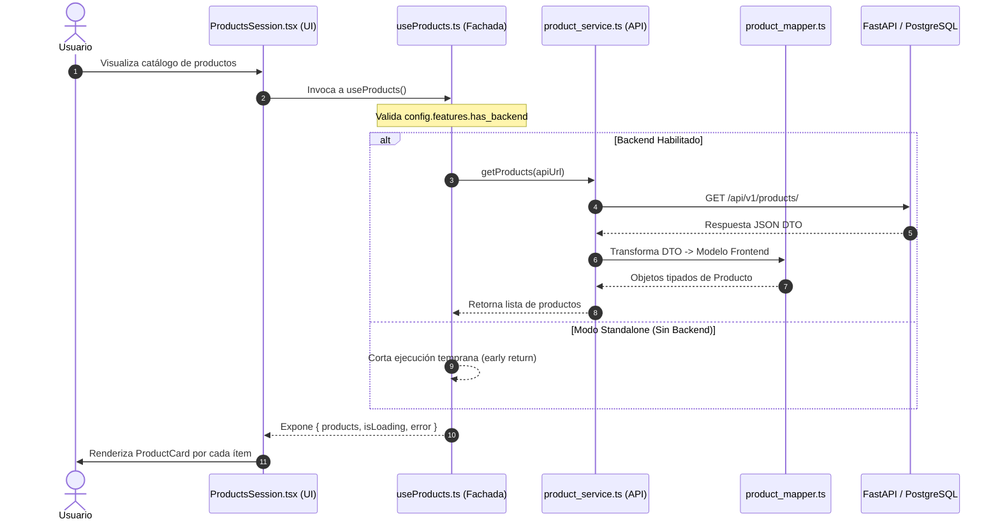

Aquí tienes el archivo **`apps/web-client/README.md`** completamente actualizado, corrigiendo las rutas duplicadas, reflejando el árbol real del proyecto (`tree -L 6`), integrando la suite `_template/` y documentando el `docker-compose.yml` real con los 3 clientes de producción (`valeria`, `malandrobarber` y `flordeloto`).

---

```markdown
<!-- apps/web-client/README.md -->
# 🚀 Web Client — Motor Web y E-commerce Agnóstico (SaaS Multi-Tenant)

Plataforma Web y Motor de E-commerce **multi-tenant de marca blanca (White-Label)** desarrollado con **React 19**, **Vite 6**, **TypeScript** y **Tailwind CSS v3**.

El proyecto opera bajo una **Arquitectura de Aislamiento por Silos en Tiempo de Ejecución (Zero-Rebuild)**: una única imagen de contenedor sirve a múltiples clientes comerciales (veterinarias, barberías, boutiques de moda, herrerías) adaptando su identidad, pasarelas de pago, módulos funcionales y catálogo de servicios/productos **sin recompilar el bundle de JavaScript**.

---

## 📖 Sub-Documentaciones Modulares (Vistas Principales)

Para facilitar la lectura y auditoría técnica del código, los módulos de mayor volumen cuentan con su propia especificación:

* 🏠 **[Módulo Landing Page (`src/pages/landing/README.md`)](src/pages/landing/README.md)**:  
  Orquestación de [`LlandingPage.tsx`](src/pages/landing/LlandingPage.tsx), máquina de alternancia matricial de colores, stacking context de 4 niveles (`z-index`), animaciones volumétricas 3D y desglose de `sessions/` ([`HeaderSession`](src/pages/landing/sessions/HederSession.tsx), [`HeroSession`](src/pages/landing/sessions/HeroSession.tsx), [`ProductsSession`](src/pages/landing/sessions/ProductsSession.tsx), [`ServicioSession`](src/pages/landing/sessions/ServicioSession.tsx), [`PlanSession`](src/pages/landing/sessions/PlanSession.tsx), [`MapsSession`](src/pages/landing/sessions/MapsSession.tsx) y [`FooterSession`](src/pages/landing/sessions/FooterSession.tsx)).

* 🛒 **[Módulo de Pedidos y Carrito (`src/pages/pedido/README.md`)](src/pages/pedido/README.md)**:  
  Panel lateral Off-Canvas ([`PedidoDrawer.tsx`](src/pages/pedido/PedidoDrawer.tsx)), edición de cantidad en línea ([`PedidoItemRow.tsx`](src/pages/pedido/PedidoItemRow.tsx)), acordeón colapsable con selección de pago y logística de entrega ([`PedidoFooterCollapsible.tsx`](src/pages/pedido/PedidoFooterCollapsible.tsx)) y generador del payload para WhatsApp.

---

## 🚀 Stack Tecnológico

- **[React 19](https://react.dev/)**: Biblioteca base para UI reactiva basada en componentes y concurrencia.
- **[Vite](https://vitejs.dev/)**: Bundler y entorno de desarrollo con Hot Module Replacement (HMR).
- **[TypeScript 5.x](https://www.typescriptlang.org/)**: Tipado estricto en contratos de datos, DTOs y validaciones de configuración.
- **[Tailwind CSS v3.4](https://tailwindcss.com/)**: Motor de utilidades con tokens semánticos dinámicos (`vete-*`) respaldados por variables CSS en formato RGB.
- **[React Router DOM v7](https://reactrouter.com/)**: Enrutador SPA (`/` para Landing, `/mantenimiento` para contingencia).
- **[Lucide React](https://lucide.dev/) + Custom SVGs**: Iconografía vectorial escalable para interfaz y marcas registradas.
- **Docker + NGINX Alpine**: Despliegue de producción inmutable con enrutamiento SPA y proxy inverso hacia FastAPI.

---

## 🏢 Arquitectura Multi-Tenant (Zero-Rebuild SaaS)

La separación estricta entre **identidad del tenant** y **código fuente** garantiza despliegues inmediatos:

```text
1. [Directorio de Clientes Host]
   clients/<cliente>/config.json + assets/
           │
           ▼ (Montaje de volúmenes Docker o switch-tenant.js)
2. [Entorno Web Público]
   public/config/client_info.json + public/tenant/
           │
           ▼ (fetch('/config/client_info.json') al arrancar la SPA)
3. [TenantProvider (src/context/tenant_context.tsx)]
   - Descarga client_info.json y sanea comentarios JSON en memoria (stripJsonComments)
   - Valida la integridad estructural mediante la interfaz TenantConfig
   - Actualiza document.title y favicon
           │
           ▼
4. [Inyector de Tema (src/config/theme_config.ts)]
   - Transforma colores Hexadecimales (#275D9E) a canales RGB ("39 93 158")
   - Inyecta variables CSS en document.documentElement (:root)
           │
           ▼
5. [Tailwind CSS + Componentes de Presentación]
   - Clases semánticas (bg-vete-primary, text-vete-base) consumen las variables CSS
   - Los elementos gráficos consumen rutas relativas fijas (/tenant/logo.png, /tenant/hero.png)
```

---

## 🔄 Flujo de Integración Frontend-Backend

El catálogo transaccional sigue el patrón **Fachada (Facade)** desacoplando la UI de la infraestructura de red:



---

## 🎨 Diccionario de Tokens Semánticos (`vete-*`)

Queda prohibido el uso de nombres de colores fijos de Tailwind (`bg-blue-600`, `text-black`). Todo componente debe consumir exclusivamente los tokens institucionales del tema activo:

| Token Semántico | Uso Exclusivo en Componentes |
| :--- | :--- |
| `bg-vete-primary` / `text-vete-primary` | Color principal de marca (Botones de acción, enlaces activos, iconos destacados). |
| `hover:bg-vete-primary-hover` | Estado hover exclusivo para elementos con color primario. |
| `bg-vete-secondary` / `text-vete-secondary` | Color secundario institucional (Badges, acentos complementarios, fondos alternos). |
| `bg-vete-tertiary` / `text-vete-tertiary` | Color para canales de contacto directo (WhatsApp, llamadas). |
| `bg-vete-dark` | Fondos oscuros estructurales (Header, Footers, modales, draweres). |
| `bg-vete-surface` | Fondo para tarjetas, contenedores de productos y áreas de contenido claro. |
| `bg-vete-soft` / `text-vete-soft` | Tinte suave con color de marca (fondos de selección, chips pasivos). |
| `bg-vete-overlay` | Fondos con oscurecimiento para capas superiores (backdrops de modales/drawers). |
| `text-vete-base` | Color tipográfico principal para textos de lectura continua y títulos sobre fondos claros. |
| `text-vete-muted` | Color tipográfico secundario (subtítulos, descripciones, placeholders, etiquetas pasivas). |
| `border-vete-subtle` | Bordes suaves y líneas divisorias. |
| `text-vete-error` / `bg-vete-error` | Acciones destructivas (vaciar carrito, eliminar producto, alertas de validación). |

---

## 📂 Estructura Completa del Repositorio

Árbol de directorios fidedigno del proyecto, la suite de clientes y el cliente web:


```text


├── 📁 public/

    clientes/_template/
   ├── 📁 assets/                                 # 🖼️ Recursos multimedia montados en /tenant/
   │   ├── 📁 animations/
   │   │   └── 📄 hero_animation.json             # Lottie interactivo de portada
   │   │
   │   ├── 📁 trabajos/                           # 💼 Galería para portfolio_section
   │   │   ├── 📄 1-1.png                         # Muestra de proyecto 1 (Foto A)
   │   │   ├── 📄 1-2.png                         # Muestra de proyecto 1 (Foto B)
   │   │   └── 📄 2-1.png                         # Muestra de proyecto 2
   │   │
   │   ├── 📄 logo.png                            # Isotipo rasterizado principal
   │   ├── 📄 logo.svg                            # Isotipo vectorial de alta definición
   │   ├── 📄 hero.png                            # Imagen principal del Hero (Mascota, Barbero, etc.)
   │   ├── 📄 ambient.webm                        # Video 3D transparente de fondo (Scroll reactivo)
   │   ├── 📄 nav.png                             # Textura de la barra inferior (pasto, madera, etc.)
   │   ├── 📄 producto_no_disponible.png          # Placeholder fallback para catálogo
   │   ├── 📄 carrito.svg                         # Icono decorativo de compras
   │   │
   │   ├── 📄 mision.png                          # Foto de bloque institucional Misión
   │   ├── 📄 vision.png                          # Foto de bloque institucional Visión
   │   ├── 📄 valores.png                         # Foto de bloque institucional Valores
   │   │
   │   ├── 📄 hero-title1.png                     # Título gráfico superior del Hero (Opcional)
   │   ├── 📄 services-title1.png                 # Título gráfico superior de Servicios (Opcional)
   │   ├── 📄 plans-title1.png                    # Título gráfico superior de Planes (Opcional)
   │   └── 📄 location-title1.png                 # Título gráfico superior de Ubicación (Opcional)
   │
   ├── 📄 config.json                             # ⚙️ Esquema maestro de configuración
   ├── 📄 generator.html                          # 🖥️ Suite visual para previsualizar y editar clientes
   ├── 📄 generator.js                            # ⚙️ Lógica de reactividad de generator.html
   └── 📄 PaletaColores.svg                       # Referencia de tokens cromáticos
   └── 📁 apps/web-client/                             # 💻 Código fuente Frontend (React 19 + Vite)
    ├── 📄 Dockerfile                              # Compilación NGINX multi-stage optimizada
    ├── 📄 docker-compose.yml                      # Orquestador multi-contenedor por cliente
    ├── 📄 nginx.conf.template                     # Plantilla NGINX con proxy dinámico ${BACKEND_HOST}
    ├── 📄 package.json                            # Manifiesto de dependencias y scripts CLI
    ├── 📄 postcss.config.js                       # Pipeline de PostCSS y Autoprefixer
    ├── 📄 tailwind.config.js                      # Configuración de diseño y tokens semánticos
    ├── 📄 tsconfig.json / tsconfig.app.json       # Configuración TypeScript del compilador
    ├── 📄 tsconfig.node.json                      # Configuración TypeScript para entorno Node/Vite
    ├── 📄 vite.config.ts                          # Configuración de Vite y proxy local /api
    ├── 📄 eslint.config.js                        # Reglas de auditoría estática (ESLint Flat Config)
    ├── 📄 index.html                              # Punto de entrada HTML de la SPA
    │
    ├── 📁 public/                                 # Directorio servido en raíz por el servidor
    │   ├── 📁 config/
    │   │   └── 📄 client_info.json                # Archivo inyectado en runtime
    │   ├── 📁 tenant/                             # Montaje de assets del cliente activo
    │   └── 📁 assets/branding/                    # Recursos gráficos compartidos globales
    │
    ├── 📁 scripts/
    │   └── 📄 switch-tenant.js                    # Script Node.js para alternar cliente local
    │
    └── 📁 src/
        ├── 📄 App.tsx                             # Enrutador principal (React Router DOM v7)
        ├── 📄 main.tsx                            # Punto de entrada concurrente (createRoot)
        ├── 📄 index.css                           # Directivas base de Tailwind CSS
        ├── 📄 vite-env.d.ts                       # Tipado global de entorno Vite
        │
        ├── 📁 config/                             # Inyectores y parámetros de UI
        │   ├── 📄 theme_config.ts                 # Transforma Hex a variables CSS RGB (:root)
        │   └── 📄 ui-config.ts                    # Constantes visuales de la interfaz
        │
        ├── 📁 context/                            # Proveedores de estado global (React Context)
        │   ├── 📄 tenant_context.tsx              # Carga y expone client_info.json vía useConfig()
        │   ├── 📄 pedido_context.tsx              # Estado del carrito de compras y persistencia
        │   └── 📄 auth_context.tsx                # Sesión y credenciales de usuario
        │
        ├── 📁 types/                              # Interfaces TypeScript estrictas
        │   ├── 📄 tenant_types.ts                 # Esquema de contrato de config.json
        │   ├── 📄 product_types.ts                # Modelos de catálogo y categorías
        │   ├── 📄 pedido_types.ts                 # Modelos de líneas de pedido y checkout
        │   ├── 📄 payment_types.ts                # Pasarelas de cobro y transferencias
        │   └── 📄 auth.ts                         # Tipos de autenticación
        │
        ├── 📁 hooks/                              # Custom Hooks / Fachadas de negocio
        │   ├── 📄 useProducts.ts                  # Filtrado, ordenamiento y consumo REST condicional
        │   └── 📄 useAddressManagement.ts         # Validación y guardado de direcciones
        │
        ├── 📁 services/                           # Capa HTTP pura e infraestructura
        │   ├── 📄 product_service.ts              # Cliente REST hacia endpoints de FastAPI
        │   ├── 📄 auth_service.ts                 # Manejo de tokens JWT y credenciales
        │   └── 📄 logger.ts                       # Registrador de eventos de sistema
        │
        ├── 📁 mapper/                             # Transformación de datos DTO -> Frontend
        │   └── 📄 product_mapper.ts               # Mapeador de respuestas de la API
        │
        ├── 📁 utils/                              # Utilidades y funciones auxiliares
        │   └── 📄 categoryHelpers.tsx             # Normalización y agrupamiento de categorías
        │
        ├── 📁 components/                         # Componentes de presentación reutilizables
        │   ├── 📁 animations/
        │   │   └── 📄 AmbientScrollAnimation.tsx  # Video volumétrico WebM reactivo al scroll
        │   ├── 📁 ProductCard/                    # Tarjetas de producto (Strategy Pattern)
        │   │   ├── 📄 ProductCard.tsx             # Despachador según config.ui_variants
        │   │   ├── 📄 ProductCardV1.tsx           # Variante plana minimalista
        │   │   └── 📄 ProductCardV2.tsx           # Variante con acordeón de especificaciones
        │   ├── 📁 studio/
        │   │   └── 📄 TenantStudioDrawer.tsx      # Cajón flotante de inspección técnica
        │   ├── 📄 FloatingBottomBar.tsx           # Barra flotante de accesos rápidos con auto-ocultado
        │   ├── 📄 SectionDivider.tsx              # Transición SVG con curvaturas dinámicas
        │   ├── 📄 ServiceCard.tsx                 # Tarjeta de servicio profesional
        │   ├── 📄 PlanCard.tsx                    # Tarjeta de plan o membresía recurrente
        │   ├── 📄 CategoryGroupCard.tsx           # Agrupador de catálogo por categorías
        │   ├── 📄 ConfirmationModal.tsx           # Modal genérico accesible
        │   ├── 📄 WhatsAppButtonProps.tsx         # Interfaces para botones de mensajería
        │   └── 📄 WhatsAppDynamicButton.tsx       # Botón de contacto directo con prefijo de país
        │
        └── 📁 pages/                              # Vistas enrutadas
            ├── 📁 landing/                        # 🏠 Landing Page Principal
            │   ├── 📄 LlandingPage.tsx            # Orquestador y alternador matricial de fondos
            │   ├── 📄 README.md                   # Documentación específica de Landing
            │   └── 📁 sessions/                   # Sub-secciones modulares
            │       ├── 📄 HederSession.tsx        # Barra de navegación fija superior
            │       ├── 📄 HeroSession.tsx         # Despachador de portadas (V1 a V4)
            │       ├── 📁 HeroSection/            # Variantes de Hero (V1, V2, V3, V4)
            │       ├── 📄 ProductsSession.tsx     # Catálogo con buscador y filtros
            │       ├── 📄 ServicioSession.tsx     # Grilla de servicios
            │       ├── 📄 PlanSession.tsx         # Paquetes y suscripciones
            │       ├── 📄 MapsSession.tsx         # Ubicación y mapa interactivo de Google Maps
            │       ├── 📄 AboutSection.tsx        # Misión, visión y valores corporativos
            │       └── 📄 FooterSession.tsx       # Pie de página y créditos
            │
            ├── 📁 pedido/                         # 🛒 Módulo de Checkout y Carrito
            │   ├── 📄 PedidoDrawer.tsx            # Drawer lateral de compras
            │   ├── 📄 PedidoItemRow.tsx           # Fila de ítem con selector numérico editable
            │   ├── 📄 PedidoFooterCollapsible.tsx # Acordeón con selección de pago y logística
            │   └── 📄 README.md                   # Documentación específica de Pedidos
            │
            ├── 📁 cliete/
            │   └── 📄 register_cliente.tsx        # Formulario de alta de clientes
            └── 📁 maintenance/
                └── 📄 MaintenancePage.tsx         # Vista de sitio en mantenimiento
```

---


## 🛠️ Guía de Operación Diaria y Comandos CLI

### 1. Ejecución en Desarrollo Local (Vite)

```bash
# Navegar a la carpeta del frontend
cd apps/web-client

# Instalar dependencias
npm install

# Iniciar servidor local
npm run dev
```

### 2. Alternar entre Clientes en Desarrollo Local
El script CLI `switch-tenant.js` copia en caliente la configuración y los assets del cliente elegido hacia la carpeta `public/`:

```bash
# 1. Clientes reales configurados:
npm run dev:veterinariabeltrameli  # Levanta la veterinaria en http://localhost:5173
npm run dev:flordeloto            # Levanta la boutique de moda en http://localhost:5173
npm run dev:malandrobarber        # Levanta la barbería en http://localhost:5173

# 2. Plantilla base neutral de pruebas:
npm run dev:template

# 3. Comando universal para cualquier carpeta dentro de clients/:
npm run tenant <nombre_carpeta_cliente>
```

> 💡 **Nota sobre el Backend en Local:** Si estás probando un cliente que requiere backend (`has_backend: true`, como Valeria), abre otra terminal y ejecuta su API en Python:
> ```bash
> cd apps/api-backend
> python run_desarrollo.py veterinaria
> ```
> Para clientes standalone como `flordeloto` o `malandrobarber`, no necesitas levantar el backend.

---

### 3. Crear un Nuevo Comercio en 3 Pasos

1. **Clonar la plantilla:**
   Copia la carpeta `clients/_template/` asignándole el nombre del cliente (ej: `clients/ferreteria_central/`).
2. **Definir Identidad y Recursos:**
   - Agrega su logotipo, portada e imágenes en `clients/ferreteria_central/assets/`.
   - Modifica `clients/ferreteria_central/config.json` (colores, teléfonos, servicios, horarios).
   *(Puedes usar `clients/_template/generator.html` en tu navegador para editarlo visualmente).*
3. **Probar localmente:**
   ```bash
   npm run tenant ferreteria_central
   npm run dev
   ```

---

## 🐳 Despliegue en Producción (Docker Silo Architecture)

En producción, la imagen `vetcore-web-client:latest` es compilada **una única vez**. Cada cliente corre como un contenedor aislado montando sus volúmenes en caliente:

### Archivo de Producción Real: `apps/web-client/docker-compose.yml`

```yaml
networks:
  # Red compartida donde corren Nginx Proxy Manager, Cloudflare y bases de datos
  northcode-net:
    external: true

# Plantilla base compartida para compilar la imagen agnóstica una sola vez
x-frontend-base: &frontend-build
  build:
    context: .
    dockerfile: dockerfile
  image: vetcore-web-client:latest

services:
  # ===========================================================================
  # CLIENTE 1: Veterinaria Beltramelli (Con Backend FastAPI Activo)
  # ===========================================================================
  front-valeria:
    <<: *frontend-build
    container_name: nc-web-valeria
    restart: unless-stopped
    ports:
      - "8081:80"
    environment:
      - BACKEND_HOST=backend-vet-bel:8000 # Proxy inverso hacia su backend dedicado
    volumes:
      - ../../clients/veterinariabeltrameli/config.json:/usr/share/nginx/html/config/client_info.json:ro
      - ../../clients/veterinariabeltrameli/assets:/usr/share/nginx/html/tenant:ro
    networks:
      - northcode-net

  # ===========================================================================
  # CLIENTE 2: Malandro Barber (Standalone / Sin Backend)
  # ===========================================================================
  front-malandrobarber:
    <<: *frontend-build
    container_name: nc-web-malandrobarber
    restart: unless-stopped
    ports:
      - "8082:80"
    environment:
      - BACKEND_HOST=127.0.0.1:80 # Host loopback seguro
    volumes:
      - ../../clients/malandrobarber/config.json:/usr/share/nginx/html/config/client_info.json:ro
      - ../../clients/malandrobarber/assets:/usr/share/nginx/html/tenant:ro
    networks:
      - northcode-net

  # ===========================================================================
  # CLIENTE 3: Flor de Loto (Boutique de Indumentaria / Sin Backend)
  # ===========================================================================
  front-flordeloto:
    <<: *frontend-build
    container_name: nc-web-flordeloto
    restart: unless-stopped
    ports:
      - "8083:80"
    environment:
      - BACKEND_HOST=127.0.0.1:80 # Pedidos procesados directo en cliente vía WhatsApp
    volumes:
      - ../../clients/flordeloto/config.json:/usr/share/nginx/html/config/client_info.json:ro
      - ../../clients/flordeloto/assets:/usr/share/nginx/html/tenant:ro
    networks:
      - northcode-net
```

### Comandos de Despliegue de Producción:
```bash
# Levantar una instancia puntual:
sudo docker compose up -d --build front-valeria
sudo docker compose up -d front-malandrobarber
sudo docker compose up -d front-flordeloto

# Levantar todos los tenants simultáneamente:
sudo docker compose up -d --build
```

---

## 🌐 Configuración en Nginx Proxy Manager (NPM)

Para exponer cada tenant hacia internet con certificado SSL automático (Let's Encrypt):

1. **Host:** Crear un nuevo **Proxy Host**.
2. **Domain Names:** `veterinaria-beltramelli.com`, `malandrobarber.northcode-uy.com`, `flordeloto.northcode-uy.com`.
3. **Scheme:** `http`
4. **Forward Hostname / IP:** El nombre del contenedor en Docker (`nc-web-valeria`, `nc-web-malandrobarber` o `nc-web-flordeloto`).
5. **Forward Port:** `80`.
6. **Opciones:**
   - [x] **Block Common Exploits**
   - [x] **Websockets Support**
   - [ ] *Cache Assets: Apagado (para reflejar cambios en volúmenes inmediatamente).*
7. **Pestaña SSL:** Solicitar certificado Let's Encrypt con **Force SSL** y **HTTP/2 Support**.

---

## 📄 Licencia
© 2026 **VetCore Platform** — Desarrollado por **[NorthCode](https://github.com/NorthCodeUY)**.  
Arquitectura de Silos Multi-tenant y Motor E-commerce de Marca Blanca.
```