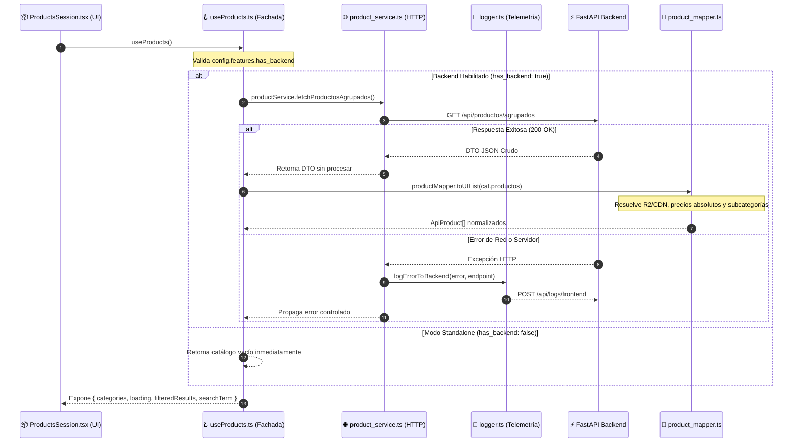

<!-- apps/web-client/README.md -->

# 🚀 Web Client — Motor Web y E-commerce Agnóstico (SaaS Multi-Tenant)

Plataforma Web y Motor de E-commerce **multi-tenant de marca blanca (White-Label)** desarrollado con **React 19**, **Vite 6**, **TypeScript 5** y **Tailwind CSS v3.4**.

El proyecto opera bajo una **Arquitectura de Aislamiento por Silos en Tiempo de Ejecución (Zero-Rebuild)**: una única imagen inmutable de contenedor sirve a múltiples clientes comerciales (veterinarias, barberías, boutiques de moda, herrerías) adaptando su identidad corporativa, pasarelas de pago, módulos funcionales y catálogo de servicios/productos **sin recompilar el bundle de JavaScript**.

---

## 📖 Sub-Documentaciones Modulares y Arquitectura

Para facilitar la auditoría técnica y lectura del código, la documentación se organiza en módulos especializados:

* 🏠 **[Módulo Landing Page (`src/pages/landing/README.md`)](src/pages/landing/README.md)**:  
  Orquestación de [`LlandingPage.tsx`](src/pages/landing/LlandingPage.tsx), máquina de alternancia matricial de fondos, jerarquía de 6 niveles de stacking context (`z-index`), animación ambiental 3D en WebM y desglose de las secciones en `sessions/` ([`HeaderSession`](src/pages/landing/sessions/HederSession.tsx), [`HeroSession`](src/pages/landing/sessions/HeroSession.tsx), [`ProductsSession`](src/pages/landing/sessions/ProductsSession.tsx), [`ServicioSession`](src/pages/landing/sessions/ServicioSession.tsx), [`PlanSession`](src/pages/landing/sessions/PlanSession.tsx), [`PortfolioSession`](src/pages/landing/sessions/PortfolioSession.tsx), [`MapsSession`](src/pages/landing/sessions/MapsSession.tsx) y [`FooterSession`](src/pages/landing/sessions/FooterSession.tsx)).

* 🛒 **[Módulo de Pedidos y Carrito (`src/pages/pedido/README.md`)](src/pages/pedido/README.md)**:  
  Panel lateral Off-Canvas ([`PedidoDrawer.tsx`](src/pages/pedido/PedidoDrawer.tsx)), edición de cantidad numérica en vivo ([`PedidoItemRow.tsx`](src/pages/pedido/PedidoItemRow.tsx)), acordeón colapsable con selección de pago y logística ([`PedidoFooterCollapsible.tsx`](src/pages/pedido/PedidoFooterCollapsible.tsx)), persistencia en URL por Deep Linking (`?cart=...`) y generador del mensaje estructurado para WhatsApp.

* 🏛️ **[Diagrama de Arquitectura Global (`docs/architecture/diagrama_arquitectura_fontend.md`)](docs/architecture/diagrama_arquitectura_fontend.md)**:  
  Esquema interactivo de capas: Configuración en Runtime, Infraestructura HTTP, Capa de Estado y Fachadas (Hooks), y Capa de Presentación UI.

* 🔄 **[Diagrama de Secuencia de Integración (`docs/architecture/diagrama_secuencia_fronten.md`)](docs/architecture/diagrama_secuencia_fronten.md)**:  
  Flujo transaccional completo: Inicialización Zero-Rebuild $\rightarrow$ Petición REST a FastAPI $\rightarrow$ Mapeo DTO $\rightarrow$ Carrito con clave compuesta $\rightarrow$ Despacho por WhatsApp.

* 📑 **[Overview Integral de Arquitectura (`docs/architecture/overview.md`)](docs/architecture/overview.md)**:  
  Especificación profunda de principios de diseño, contratos de datos, patrones de integración y reglas de diseño defensivo Anti-NaN.

---

## 🛠️ Stack Tecnológico Oficial

El frontend se apoya en tecnologías modernas del ecosistema web:

- ⚛️ **[React 19](https://react.dev/)**: Biblioteca base para UI reactiva basada en componentes, concurrencia y hooks nativos (`useMemo`, `useCallback`, `useContext`).
- ⚡ **[Vite 6](https://vite.dev/)**: Bundler ultrarrápido con Hot Module Replacement (HMR) y proxy inverso para desarrollo local.
- 📘 **[TypeScript 5.x](https://www.typescriptlang.org/docs/)**: Tipado estricto en contratos de datos, DTOs de API y validaciones de configuración en runtime.
- 🎨 **[Tailwind CSS v3.4](https://tailwindcss.com/docs)**: Motor de utilidades CSS con tokens semánticos dinámicos (`vete-*`) mapeados a variables CSS en canales RGB.
- 🧭 **[React Router DOM v7](https://reactrouter.com/)**: Enrutador declarativo para SPAs (`/` para Landing, `/mantenimiento` para contingencia técnica).
- 🧩 **[Lucide React](https://lucide.dev/)**: Iconografía vectorial escalable para interfaz y resolución agnóstica de subcategorías.
- 🐳 **[Docker Engine](https://docs.docker.com/) + NGINX Alpine**: Imagen de producción inmutable con enrutamiento SPA y proxy dinámico hacia FastAPI.
- 🚀 **[FastAPI](https://fastapi.tiangolo.com/)**: Servidor backend RESTful montado en contenedor independiente por silo.

---

## 🏢 Arquitectura Multi-Tenant (Zero-Rebuild SaaS)

La separación estricta entre la **identidad del tenant** y el **código fuente** garantiza despliegues inmediatos sin recompilaciones:

```mermaid
flowchart TD
    subgraph Host ["💻 Directorio de Clientes (Host)"]
        ClientConfig["clients/<cliente>/config.json"]
        ClientAssets["clients/<cliente>/assets/*"]
    end

    subgraph ContainerMount ["🐳 Montaje en Runtime (Docker / switch-tenant.js)"]
        PublicConfig["public/config/client_info.json"]
        PublicTenant["public/tenant/*"]
    end

    subgraph FrontendApp ["🚀 Aplicación Web (React 19 + TypeScript)"]
        Provider["🏢 TenantProvider (tenant_context.tsx)"]
        Sanitize["🧹 stripJsonComments()"]
        Theme["🎨 Inyector de Tema (theme_config.ts)"]
        RootCSS[":root { --vete-primary: R G B }"]
        TailwindCSS["🎨 Clases Tailwind (bg-vete-primary, text-vete-base)"]
    end

    ClientConfig -->|Volumen :ro| PublicConfig
    ClientAssets -->|Volumen :ro| PublicTenant

    PublicConfig -->|fetch('/config/client_info.json')| Provider
    Provider --> Sanitize
    Sanitize --> Theme
    Theme --> RootCSS
    RootCSS --> TailwindCSS
```

### Proceso de Inicialización:
1. **Montaje Estático:** En producción, Docker monta en caliente el archivo de configuración del cliente en `/public/config/client_info.json` y sus imágenes en `/public/tenant/`. En desarrollo, el comando `npm run tenant <cliente>` ejecuta [`switch-tenant.js`](scripts/switch-tenant.js) para sincronizar estos archivos.
2. **Saneamiento Defensivo:** [`tenant_context.tsx`](src/context/tenant_context.tsx) descarga `client_info.json` y ejecuta `stripJsonComments()`, eliminando comentarios `//` y `/* */` antes de deserializar.
3. **Inyección Cromática Dinámica:** [`theme_config.ts`](src/config/theme_config.ts) transforma los códigos Hexadecimales (`#275D9E`) a canales decimales RGB (`39 93 158`) e inyecta las variables CSS nativas en `document.documentElement` (`:root`).
4. **Consumo Semántico:** Las clases Tailwind `bg-vete-primary`, `bg-vete-secondary`, `bg-vete-dark` y `text-vete-base` consumen estas variables inmediatamente, adaptando la interfaz al comercio activo.

---

## 🔄 Comunicación con el Backend y Capa de Infraestructura

El consumo del backend se desacopla mediante el patrón **Fachada (Facade)** y una **Capa Anti-Corrupción (Mapper)**:



### 1. Proxy Inverso para Evitar CORS
El cliente web siempre emite peticiones a rutas relativas `/api/*`:
* **En Desarrollo (Vite):** En [`vite.config.ts`](vite.config.ts), se intercepta `/api` y se redirige hacia `http://localhost:${backendPort}` (por defecto `8001`).
* **En Producción (NGINX):** [`nginx.conf.template`](nginx.conf.template) redirige `/api/` hacia `http://${BACKEND_HOST}/api/`.

### 2. Endpoints Principales ([`product_service.ts`](src/services/product_service.ts))
* **`GET /api/productos/agrupados`**: Descarga la lista completa de categorías con sus productos anidados para el catálogo general.
* **`GET /api/productos?cat_id={id}`**: Permite carga bajo demanda (Lazy Loading) de productos de una categoría específica.
* **`POST /api/logs/frontend`**: Endpoint consumido por [`logger.ts`](src/services/logger.ts) para despachar silenciosamente excepciones de red y errores de runtime ocurridos en el navegador.

### 3. Transformación de Datos ([`product_mapper.ts`](src/mapper/product_mapper.ts))
FastAPI envía DTOs asociados a modelos relacionales. El mapeador asegura que la UI reciba objetos confiables y tipados:
* **Resolución de Imágenes:** Si la URL proviene de Cloudflare R2 o CDN (`https://...`), se mantiene. Si es relativa, antepone `/static/productos/`. Si no existe imagen, asigna el fallback `/tenant/producto_no_disponible.png`. Soporta el schema del backend (`rel_imagenes`, `imagenes`, `rel_imagen_url`).
* **Variantes con Precios Absolutos:** Asigna `var_precio_venta` como valor numérico final, filtrando variantes inactivas (`var_activo !== false` y `var_visible !== false`).
* **Subcategorías e Iconos:** Extrae la relación (`subcategorias[].subcategoria`) y mapea iconos dinámicos de Lucide o archivos SVG personalizados.
* **Guardias de Visibilidad:** Descarta productos que tengan `prod_activo: false` o `prod_visible: false`.

---

## 📐 Sistema de Tipos TypeScript (`src/types/`)

El tipado estricto asegura consistencia en todo el flujo de datos:

| Archivo | Contratos Principales | Responsabilidad |
| :--- | :--- | :--- |
| [`product_types.ts`](src/types/product_types.ts) | `ApiProduct`, `ProductoVariante`, `ApiCategory` | Modelos de catálogo público, reglas comerciales (`prod_solo_variantes`, `prod_disponible`), stock y variantes vendibles. |
| [`tenant_types.ts`](src/types/tenant_types.ts) | `TenantConfig`, `ThemeColors`, `FeaturesConfig`, `BrandingConfig` | Estructura completa de `config.json` con tokens de color, flags de activación y datos institucionales. |
| [`pedido_types.ts`](src/types/pedido_types.ts) | `PedidoItem`, `PedidoOrderRequest` | Línea de carrito con clave compuesta `item_key`, variante seleccionada y precio unitario capturado. |
| [`payment_types.ts`](src/types/payment_types.ts) | `PaymentMethodId`, `PaymentOption` | Identificadores de medios de pago (`efectivo`, `transferencia`, `tarjeta`, `mercadopago`) y generador de notas. |
| [`category_types.ts`](src/types/category_types.ts) | `SubcategoriaItem`, `CategoriaBase` | Especies o tags de filtrado con soporte de icono Lucide (`subc_icono`) o SVG propio (`subc_imagen_url`). |
| [`common_types.ts`](src/types/common_types.ts) | `ApiImage`, `Color` | Estructura genérica para imágenes y swatches cromáticos (`col_hex`, `col_nombre`). |
| [`auth.ts`](src/types/auth.ts) | `UserProfile`, `AuthCredentials` | Contratos de usuario y autenticación para futuras extensiones. |

---

## 🛒 Gestión del Carrito y Prevención de NaN (Anti-NaN)

Ubicado en [`src/context/pedido_context.tsx`](src/context/pedido_context.tsx) y [`src/hooks/useProducts.ts`](src/hooks/useProducts.ts):

1. **Clave Compuesta Única (`item_key`):**  
   Se genera como `${prod_id}_${var_id}` para productos con variantes o `${prod_id}_base` para productos simples. Esto permite al cliente tener en el carrito el mismo producto en talles distintos sin que se pisen entre sí.
2. **Cálculo de Precios Anti-NaN:**  
   Se utiliza `Number(...) || 0` en cada paso aritmético. Las variantes contienen un precio absoluto (`var_precio_venta`), eliminando la fragilidad de sumas relativas.
3. **Persistencia Bidireccional en URL (Deep Linking):**  
   El hook `useProducts` sincroniza en tiempo real el carrito en la URL del navegador (`?cart=prodId_varId:cantidad`). Al abrir un enlace compartido, el hook rehidrata el pedido completo de manera automática.
4. **Despacho Directo a WhatsApp:**  
   `getWhatsAppUrl` formatea un mensaje estructurado con desglose de ítems, talle/color, subtotales, método de pago, datos de cuenta bancaria y dirección de entrega, abriendo el chat de WhatsApp con el comercio en un clic.

---

## 🎨 Diccionario de Tokens Semánticos (`vete-*`)

Queda prohibido utilizar nombres de colores estáticos de Tailwind (`bg-blue-600`, `text-black`). Todo componente debe consumir los tokens institucionales del tema activo:

| Token Semántico | Uso Exclusivo en Componentes |
| :--- | :--- |
| `bg-vete-primary` / `text-vete-primary` | Color principal de marca (Botones de acción CTA, enlaces activos, iconos destacados). |
| `hover:bg-vete-primary-hover` | Estado hover exclusivo para elementos con color primario. |
| `bg-vete-secondary` / `text-vete-secondary` | Color secundario institucional (Badges, acentos complementarios, fondos alternos). |
| `bg-vete-tertiary` / `text-vete-tertiary` | Color para canales de contacto directo (WhatsApp, llamadas). |
| `bg-vete-dark` | Fondos oscuros estructurales (Header, Footers, modales, draweres). |
| `bg-vete-surface` | Fondo para tarjetas, contenedores de productos y áreas de contenido claro. |
| `bg-vete-soft` / `text-vete-soft` | Tinte suave con color de marca (fondos de selección, chips pasivos). |
| `bg-vete-overlay` | Fondos con oscurecimiento para capas superiores (backdrops de modales/drawers). |
| `text-vete-base` | Color tipográfico principal para textos de lectura continua y títulos sobre fondos claros. |
| `text-vete-muted` | Color tipográfico secundario (subtítulos, descripciones, placeholders, etiquetas pasivas). |
| `border-vete-subtle` | Bordes suaves y líneas divisorias. |
| `text-vete-error` / `bg-vete-error` | Acciones destructivas (vaciar carrito, eliminar producto, alertas de validación). |

---

## 📂 Estructura Completa del Repositorio (Navegable)

> 💡 **Tip:** Haz clic en cualquier archivo o carpeta para abrirlo directamente en tu editor:

* 📁 **[clients/](../../clients/)** *(Silos de configuración por cliente)*
  * 📁 **[veterinariabeltrameli/](../../clients/veterinariabeltrameli/)** *(Cliente Veterinaria con backend)*
  * 📁 **[malandrobarber/](../../clients/malandrobarber/)** *(Cliente Barbería Standalone)*
  * 📁 **[flordeloto/](../../clients/flordeloto/)** *(Cliente Boutique Standalone)*
  * 📁 **[_template/](../../clients/_template/)** *(Plantilla agnóstica para clonar nuevos comercios)*
    * 📁 **[assets/](../../clients/_template/assets/)** *(Imágenes, logos y animación WebM)*
    * 📄 [config.json](../../clients/_template/config.json) *(Esquema maestro de configuración)*
* 📁 **apps/web-client/** *(Código fuente Frontend)*
  * 📄 [dockerfile](dockerfile) *(Compilación NGINX multi-stage inmutable)*
  * 📄 [docker-compose.yml](docker-compose.yml) *(Orquestador multi-contenedor con red northcode-net)*
  * 📄 [nginx.conf.template](nginx.conf.template) *(Plantilla NGINX con proxy dinámico ${BACKEND_HOST})*
  * 📄 [package.json](package.json) *(Scripts CLI y dependencias React 19)*
  * 📄 [vite.config.ts](vite.config.ts) *(Configuración de empaquetador y proxy local /api)*
  * 📄 [tailwind.config.js](tailwind.config.js) *(Tokens semánticos vete-* y breakpoints)*
  * 📄 [postcss.config.js](postcss.config.js) *(Pipeline PostCSS)*
  * 📄 [eslint.config.js](eslint.config.js) *(Auditoría estática ESLint)*
  * 📄 [index.html](index.html) *(Punto de entrada HTML y montaje del DOM)*
  * 📁 **[public/](public/)**
    * 📁 **[config/](public/config/)**
      * 📄 [client_info.json](public/config/client_info.json) *(Configuración inyectada en runtime)*
    * 📁 **[tenant/](public/tenant/)** *(Assets montados del tenant activo)*
  * 📁 **[scripts/](scripts/)**
    * 📄 [switch-tenant.js](scripts/switch-tenant.js) *(Conmutador de cliente en desarrollo local)*
  * 📁 **[docs/](docs/)**
    * 📁 **[architecture/](docs/architecture/)**
      * 📄 [diagrama_arquitectura_fontend.md](docs/architecture/diagrama_arquitectura_fontend.md) *(Diagrama interactivo de capas)*
      * 📄 [diagrama_secuencia_fronten.md](docs/architecture/diagrama_secuencia_fronten.md) *(Diagrama de secuencia de integración)*
      * 📄 [overview.md](docs/architecture/overview.md) *(Overview integral de arquitectura)*
  * 📁 **[src/](src/)**
    * 📄 [App.tsx](src/App.tsx) *(Enrutador principal React Router DOM v7)*
    * 📄 [main.tsx](src/main.tsx) *(Punto de entrada concurrente createRoot)*
    * 📄 [index.css](src/index.css) *(Directivas base Tailwind)*
    * 📁 **[config/](src/config/)**
      * 📄 [theme_config.ts](src/config/theme_config.ts) *(Inyector Hex -> RGB en :root)*
      * 📄 [ui-config.ts](src/config/ui-config.ts) *(Parámetros visuales de UI)*
    * 📁 **[context/](src/context/)**
      * 📄 [tenant_context.tsx](src/context/tenant_context.tsx) *(Carga de client_info.json vía useConfig())*
      * 📄 [pedido_context.tsx](src/context/pedido_context.tsx) *(Store del carrito Anti-NaN y persistencia)*
      * 📄 [auth_context.tsx](src/context/auth_context.tsx) *(Gestión de sesión)*
    * 📁 **[types/](src/types/)**
      * 📄 [product_types.ts](src/types/product_types.ts) *(Contratos de productos y variantes)*
      * 📄 [tenant_types.ts](src/types/tenant_types.ts) *(Contratos de configuración del tenant)*
      * 📄 [pedido_types.ts](src/types/pedido_types.ts) *(Contratos de líneas de pedido)*
      * 📄 [payment_types.ts](src/types/payment_types.ts) *(Contratos de formas de pago)*
      * 📄 [category_types.ts](src/types/category_types.ts) *(Contratos de subcategorías e iconos)*
      * 📄 [common_types.ts](src/types/common_types.ts) *(Contratos de imágenes y colores)*
    * 📁 **[hooks/](src/hooks/)**
      * 📄 [useProducts.ts](src/hooks/useProducts.ts) *(Fachada de catálogo, buscador y Deep Linking)*
      * 📄 [useAddressManagement.ts](src/hooks/useAddressManagement.ts) *(Gestión de direcciones de entrega)*
    * 📁 **[services/](src/services/)**
      * 📄 [product_service.ts](src/services/product_service.ts) *(Cliente HTTP REST hacia FastAPI)*
      * 📄 [logger.ts](src/services/logger.ts) *(Telemetría de errores hacia /api/logs/frontend)*
      * 📄 [auth_service.ts](src/services/auth_service.ts) *(Autenticación)*
    * 📁 **[mapper/](src/mapper/)**
      * 📄 [product_mapper.ts](src/mapper/product_mapper.ts) *(Adaptador DTO backend -> UI models)*
    * 📁 **[components/](src/components/)**
      * 📁 **[animations/](src/components/animations/)**
        * 📄 [AmbientScrollAnimation.tsx](src/components/animations/AmbientScrollAnimation.tsx) *(Video 3D WebM en Capa z-[45])*
      * 📁 **[ProductCard/](src/components/ProductCard/)**
        * 📄 [ProductCard.tsx](src/components/ProductCard/ProductCard.tsx) *(Despachador de variante)*
        * 📄 [ProductCardV1.tsx](src/components/ProductCard/ProductCardV1.tsx) *(Variante plana)*
        * 📄 [ProductCardV2.tsx](src/components/ProductCard/ProductCardV2.tsx) *(Variante con acordeón)*
      * 📁 **[PortfolioCard/](src/components/PortfolioCard/)**
        * 📄 [PortfolioCard.tsx](src/components/PortfolioCard/PortfolioCard.tsx)
      * 📁 **[studio/](src/components/studio/)**
        * 📄 [TenantStudioDrawer.tsx](src/components/studio/TenantStudioDrawer.tsx)
      * 📄 [FloatingBottomBar.tsx](src/components/FloatingBottomBar.tsx) *(Barra flotante inferior con auto-hide)*
      * 📄 [SectionDivider.tsx](src/components/SectionDivider.tsx) *(Ondas divisorias SVG vectoriales)*
      * 📄 [ServiceCard.tsx](src/components/ServiceCard.tsx) | [PlanCard.tsx](src/components/PlanCard.tsx)
      * 📄 [CategoryGroupCard.tsx](src/components/CategoryGroupCard.tsx) | [ConfirmationModal.tsx](src/components/ConfirmationModal.tsx)
      * 📄 [WhatsAppDynamicButton.tsx](src/components/WhatsAppDynamicButton.tsx)
    * 📁 **[pages/](src/pages/)**
      * 📁 **[landing/](src/pages/landing/)** *(🏠 Vista Principal)*
        * 📄 [LlandingPage.tsx](src/pages/landing/LlandingPage.tsx) *(Orquestador y máquina matricial)*
        * 📄 [README.md](src/pages/landing/README.md) *(Sub-documentación)*
        * 📁 **[sessions/](src/pages/landing/sessions/)**
          * 📄 [HederSession.tsx](src/pages/landing/sessions/HederSession.tsx) | [HeroSession.tsx](src/pages/landing/sessions/HeroSession.tsx)
          * 📁 **[HeroSection/](src/pages/landing/sessions/HeroSection/)** ([V1](src/pages/landing/sessions/HeroSection/HeroSectionV1.tsx) | [V2](src/pages/landing/sessions/HeroSection/HeroSectionV2.tsx) | [V3](src/pages/landing/sessions/HeroSection/HeroSectionV3.tsx) | [V4](src/pages/landing/sessions/HeroSection/HeroSectionV4.tsx))
          * 📄 [ProductsSession.tsx](src/pages/landing/sessions/ProductsSession.tsx) | [ServicioSession.tsx](src/pages/landing/sessions/ServicioSession.tsx)
          * 📄 [PlanSession.tsx](src/pages/landing/sessions/PlanSession.tsx) | [PortfolioSession.tsx](src/pages/landing/sessions/PortfolioSession.tsx)
          * 📄 [MapsSession.tsx](src/pages/landing/sessions/MapsSession.tsx) | [AboutSection.tsx](src/pages/landing/sessions/AboutSection.tsx)
          * 📄 [FooterSession.tsx](src/pages/landing/sessions/FooterSession.tsx)
      * 📁 **[pedido/](src/pages/pedido/)** *(🛒 Checkout y Carrito)*
        * 📄 [PedidoDrawer.tsx](src/pages/pedido/PedidoDrawer.tsx)
        * 📄 [PedidoItemRow.tsx](src/pages/pedido/PedidoItemRow.tsx)
        * 📄 [PedidoFooterCollapsible.tsx](src/pages/pedido/PedidoFooterCollapsible.tsx)
        * 📄 [README.md](src/pages/pedido/README.md)
      * 📁 **[maintenance/](src/pages/maintenance/)**
        * 📄 [MaintenancePage.tsx](src/pages/maintenance/MaintenancePage.tsx)

---

## 🛠️ Guía de Operación Diaria y Comandos CLI

### 1. Ejecución en Desarrollo Local (Vite)

```bash
# Navegar a la carpeta del frontend
cd apps/web-client

# Instalar dependencias
npm install

# Iniciar servidor local
npm run dev
```

### 2. Alternar entre Clientes en Desarrollo Local
El script CLI [`switch-tenant.js`](scripts/switch-tenant.js) copia en caliente la configuración y los assets del cliente elegido hacia la carpeta `public/`:

```bash
# 1. Clientes reales preconfigurados:
npm run dev:veterinariabeltrameli  # Levanta la veterinaria en http://localhost:5173
npm run dev:flordeloto            # Levanta la boutique de moda en http://localhost:5173
npm run dev:malandrobarber        # Levanta la barbería en http://localhost:5173

# 2. Plantilla base neutral de pruebas:
npm run dev:template

# 3. Comando universal para cualquier carpeta dentro de clients/:
npm run tenant <nombre_carpeta_cliente>
```

> 💡 **Nota sobre el Backend en Local:** Si estás probando un cliente que requiere backend (`has_backend: true`, como Valeria), abre otra terminal y ejecuta su API en Python:
> ```bash
> cd api-backend
> python run_desarrollo.py veterinaria
> ```
> Para clientes standalone como `flordeloto` o `malandrobarber`, no necesitas levantar el backend.

---

### 3. Crear un Nuevo Comercio en 3 Pasos

1. **Clonar la plantilla:**
   Copia la carpeta `clients/_template/` asignándole el nombre del nuevo cliente (ej: `clients/ferreteria_central/`).
2. **Definir Identidad y Recursos:**
   - Agrega su logotipo, portada e imágenes en `clients/ferreteria_central/assets/`.
   - Modifica `clients/ferreteria_central/config.json` (colores, teléfonos, servicios, horarios).
3. **Probar localmente:**
   ```bash
   npm run tenant ferreteria_central
   npm run dev
   ```

---

## 🐳 Despliegue en Producción (Docker Silo Architecture)

En producción, la imagen `vetcore-web-client:latest` es compilada **una única vez** vía [`dockerfile`](dockerfile). Cada cliente corre como un contenedor aislado montando sus volúmenes en caliente:

### Archivo de Orquestación: [`apps/web-client/docker-compose.yml`](docker-compose.yml)

```yaml
networks:
  northcode-net:
    external: true

x-frontend-base: &frontend-build
  build:
    context: .
    dockerfile: dockerfile
  image: vetcore-web-client:latest

services:
  # CLIENTE 1: Veterinaria Beltramelli (Con Backend Activo)
  front-valeria:
    <<: *frontend-build
    container_name: nc-web-valeria
    restart: unless-stopped
    ports:
      - "8081:80"
    environment:
      - BACKEND_HOST=backend_vet_beltramelli:8001
    volumes:
      - ../../clients/veterinariabeltrameli/config.json:/usr/share/nginx/html/config/client_info.json:ro
      - ../../clients/veterinariabeltrameli/assets:/usr/share/nginx/html/tenant:ro
    networks:
      - northcode-net

  # CLIENTE 2: Malandro Barber (Standalone)
  front-malandrobarber:
    <<: *frontend-build
    container_name: nc-web-malandrobarber
    restart: unless-stopped
    ports:
      - "8082:80"
    environment:
      - BACKEND_HOST=127.0.0.1:80
    volumes:
      - ../../clients/malandrobarber/config.json:/usr/share/nginx/html/config/client_info.json:ro
      - ../../clients/malandrobarber/assets:/usr/share/nginx/html/tenant:ro
    networks:
      - northcode-net

  # CLIENTE 3: Flor de Loto (Standalone)
  front-flordeloto:
    <<: *frontend-build
    container_name: nc-web-flordeloto
    restart: unless-stopped
    ports:
      - "8083:80"
    environment:
      - BACKEND_HOST=127.0.0.1:80
    volumes:
      - ../../clients/flordeloto/config.json:/usr/share/nginx/html/config/client_info.json:ro
      - ../../clients/flordeloto/assets:/usr/share/nginx/html/tenant:ro
    networks:
      - northcode-net
```

### Comandos de Despliegue de Producción:
```bash
# Levantar una instancia puntual:
sudo docker compose up -d --build front-valeria
sudo docker compose up -d front-malandrobarber
sudo docker compose up -d front-flordeloto

# Levantar todos los tenants simultáneamente:
sudo docker compose up -d --build
```

---

## 🌐 Configuración en Nginx Proxy Manager (NPM)

Para exponer cada tenant hacia internet con certificado SSL automático (Let's Encrypt):

1. **Host:** Crear un nuevo **Proxy Host**.
2. **Domain Names:** `veterinaria-beltramelli.com`, `malandrobarber.northcode-uy.com`, `flordeloto.northcode-uy.com`.
3. **Scheme:** `http`
4. **Forward Hostname / IP:** El nombre del contenedor en Docker (`nc-web-valeria`, `nc-web-malandrobarber` o `nc-web-flordeloto`).
5. **Forward Port:** `80`.
6. **Opciones:**
   - [x] **Block Common Exploits**
   - [x] **Websockets Support**
   - [ ] *Cache Assets: Apagado (para reflejar cambios en volúmenes inmediatamente).*
7. **Pestaña SSL:** Solicitar certificado Let's Encrypt con **Force SSL** y **HTTP/2 Support**.

---

## 📄 Licencia y Créditos
© 2026 **VetCore Platform** — Desarrollado por **[NorthCode](https://github.com/NorthCodeUY)**.  
Arquitectura de Silos Multi-tenant y Motor E-commerce de Marca Blanca.
