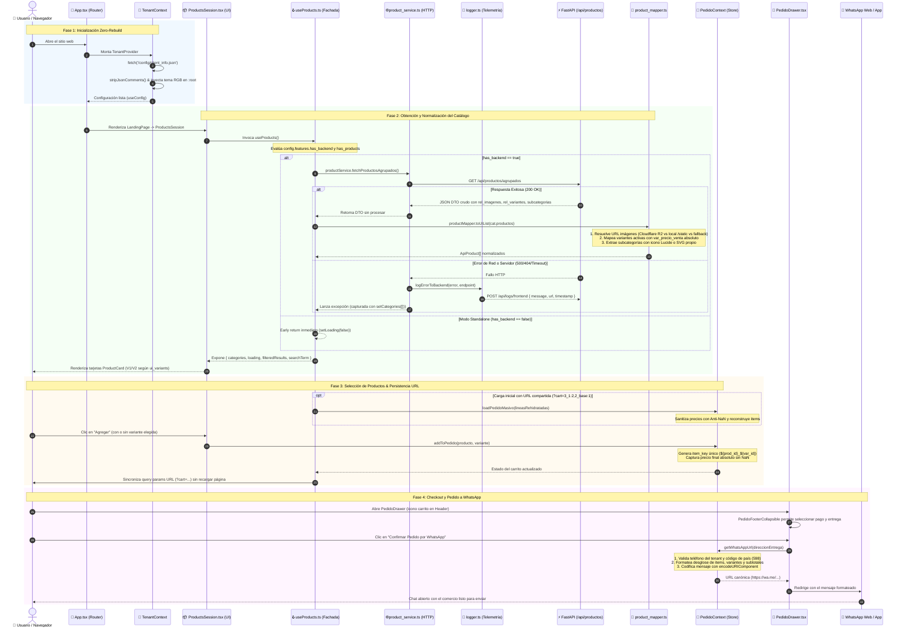

<!-- apps/web-client/docs/architecture/diagrama_secuencia_fronten.md -->

# 🔄 Diagrama de Secuencia: Ciclo de Vida e Integración Frontend-Backend

[⬅️ Volver al README Principal del Web Client](../../README.md) | [🏛️ Diagrama de Arquitectura Global](diagrama_arquitectura_fontend.md) | [📑 Overview de Arquitectura](overview.md) | [🏠 Sub-Doc: Landing](../../src/pages/landing/README.md) | [🛒 Sub-Doc: Pedidos](../../src/pages/pedido/README.md)

---

## 📌 Flujo Transaccional Completo

El siguiente diagrama detalla la interacción paso a paso entre el visitante, los componentes de la interfaz de usuario, los hooks de fachada, los servicios HTTP, el mapeador de contratos (DTOs) y el servidor backend en FastAPI:

---

## 🔍 Explicación Detallada de Cada Etapa

### 1. Inicialización en Runtime (Zero-Rebuild)
* [`tenant_context.tsx`](../../src/context/tenant_context.tsx) descarga en tiempo de ejecución el archivo `/config/client_info.json`.
* Limpia comentarios estilo `//` o `/* */` mediante `stripJsonComments` para prevenir errores de parseo en JSON nativo.
* Invoca [`theme_config.ts`](../../src/config/theme_config.ts), convirtiendo la paleta hexadecimal de colores institucionales en valores RGB numéricos e inyectándolos como variables CSS en el elemento `:root` (`document.documentElement`). De este modo, todas las clases Tailwind `bg-vete-*` y `text-vete-*` se pintan con la identidad del cliente.

### 2. Consumo HTTP y Resiliencia ante Fallos
* [`useProducts.ts`](../../src/hooks/useProducts.ts) actúa como orquestador y fachada. Si el comercio opera en modo catálogo manual (`has_backend === false`), el hook cancela la petición inmediatamente sin consumir recursos de red.
* En clientes con backend activo, [`product_service.ts`](../../src/services/product_service.ts) ejecuta la consulta `fetch('/api/productos/agrupados')`.
* Si la solicitud falla (error de red o estado $\ge 400$), se captura en un bloque `try/catch` y se despacha de forma asíncrona a [`logger.ts`](../../src/services/logger.ts), enviando una traza de telemetría a `POST /api/logs/frontend` con la URL, el mensaje de error y la marca de tiempo (ISO 8601).

### 3. Transformación y Limpieza de Datos (DTO -> UI Model)
* La respuesta cruda de FastAPI (SQLAlchemy) es procesada por [`product_mapper.ts`](../../src/mapper/product_mapper.ts):
  1. **Multimedia:** Normaliza las URLs de imágenes analizando `rel_imagenes`. Detecta URLs absolutas (Cloudflare R2 / AWS S3) y URLs locales (`/static/productos/`), asignando el fallback oficial `/tenant/producto_no_disponible.png` ante cualquier valor ausente.
  2. **Variantes:** Filtra registros donde `var_activo !== false && var_visible !== false`. Asigna el precio absoluto `var_precio_venta` evitando desajustes por sumas relativas.
  3. **Subcategorías:** Desempaqueta objetos planos o anidados (`subcategorias[].subcategoria`), extrayendo el nombre y la referencia al icono SVG o Lucide.
  4. **Guardias de Visibilidad:** Descarta automáticamente productos inactivos (`prod_activo === false` o `prod_visible === false`).

### 4. Deep Linking y Estado Reactivo del Carrito
* [`pedido_context.tsx`](../../src/context/pedido_context.tsx) gestiona cada línea mediante una clave compuesta (`item_key: string`):
  * Producto simple: `${prod_id}_base`
  * Producto con variante: `${prod_id}_${var_id}`
* Permite que un cliente agregue múltiples variantes del mismo producto (por ejemplo, Talle S y Talle L) sin que colisionen en el carrito.
* El hook [`useProducts.ts`](../../src/hooks/useProducts.ts) serializa el carrito en tiempo real hacia la barra de direcciones del navegador (`?cart=prodId_varId:cantidad`). Si otro usuario abre el enlace, el hook rehidrata automáticamente el pedido con los productos y variantes exactos.

### 5. Checkout y Cierre por WhatsApp
* [`PedidoFooterCollapsible.tsx`](../../src/pages/pedido/PedidoFooterCollapsible.tsx) ofrece 4 modalidades de pago (`efectivo`, `transferencia`, `tarjeta`, `mercadopago`). En transferencias bancarias, inyecta dinámicamente las cuentas del cliente cargadas desde `client_info.json`.
* `getWhatsAppUrl` arma un payload estructurado en Markdown de WhatsApp con saltos de línea, encabezados, lista de productos con su talle/color y total general, despachando la orden a `https://wa.me/598...`.

---

## 🔗 Navegación y Documentación de Apoyo

* 🏛️ [Ver Diagrama de Arquitectura de Capas](diagrama_arquitectura_fontend.md)
* 📑 [Leer Overview Arquitectónico Integral](overview.md)
* 🏠 [Documentación de Landing Page](../../src/pages/landing/README.md)
* 🛒 [Documentación de Pedidos y Carrito](../../src/pages/pedido/README.md)
* 📘 [README Principal del Frontend](../../README.md)
