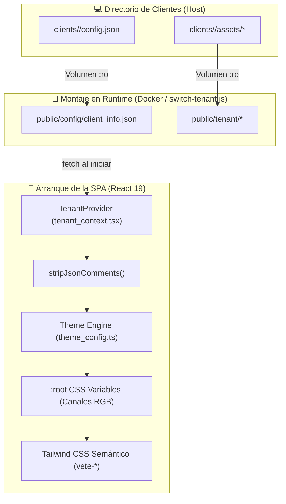

<!-- apps/web-client/docs/architecture/overview.md -->

# 🏛️ Especificación General de Arquitectura (Web Client SaaS)

[⬅️ Volver al README Principal del Web Client](../../README.md) | [🏛️ Ver Diagrama de Arquitectura](diagrama_arquitectura_fontend.md) | [🔄 Ver Diagrama de Secuencia](diagrama_secuencia_fronten.md) | [🏠 Sub-Doc: Landing](../../src/pages/landing/README.md) | [🛒 Sub-Doc: Pedidos](../../src/pages/pedido/README.md)

---

## 📑 Tabla de Contenidos

1. [Filosofía y Principios de Diseño](#-filosofía-y-principios-de-diseño)
2. [Arquitectura Multi-Tenant Zero-Rebuild](#-arquitectura-multi-tenant-zero-rebuild)
3. [Capa de Comunicación con el Backend](#-capa-de-comunicación-con-el-backend)
4. [Capa de Mapeo y Transformación de Datos (DTO a UI)](#-capa-de-mapeo-y-transformación-de-datos-dto-a-ui)
5. [Sistema de Tipos Estrictos de TypeScript](#-sistema-de-tipos-estrictos-de-typescript)
6. [Gestión de Estado y Prevención de NaN (Anti-NaN)](#-gestión-de-estado-y-prevención-de-nan-anti-nan)
7. [Motor de Presentación y Jerarquía de Capas (Z-Index)](#-motor-de-presentación-y-jerarquía-de-capas-z-index)
8. [Vínculos a Documentación Oficial](#-vínculos-a-documentación-oficial)

---

## 🌟 Filosofía y Principios de Diseño

El cliente web de **VetCore** está concebido bajo una arquitectura agnóstica de marca blanca (White-Label SaaS). Esto significa que una única base de código en **React 19**, **Vite** y **TypeScript** sirve indistintamente a clínicas veterinarias, barberías, tiendas de indumentaria, herrerías o estudios profesionales sin necesidad de compilar código específico por cliente.

### Principios Fundamentales:

1. **Aislamiento por Silos en Tiempo de Ejecución (Zero-Rebuild):** El bundle JavaScript resultante de `vite build` es 100% inmutable. Toda la personalización (paleta de colores, logotipo, banners, métodos de pago, teléfono de contacto y módulos activos) se inyecta en caliente mediante archivos estáticos externos.
2. **Desacoplamiento Estricto (Separation of Concerns):** La interfaz de usuario nunca ejecuta `fetch` directo. Se estructura en 5 capas unidireccionales:
   * **Capa 1: Configuración en Runtime** ([`tenant_context.tsx`](../../src/context/tenant_context.tsx) y [`theme_config.ts`](../../src/config/theme_config.ts)).
   * **Capa 2: Infraestructura HTTP Pura** ([`product_service.ts`](../../src/services/product_service.ts) y [`logger.ts`](../../src/services/logger.ts)).
   * **Capa 3: Mapeo y Normalización de Datos** ([`product_mapper.ts`](../../src/mapper/product_mapper.ts)).
   * **Capa 4: Fachada de Negocio y Estado** ([`useProducts.ts`](../../src/hooks/useProducts.ts) y [`pedido_context.tsx`](../../src/context/pedido_context.tsx)).
   * **Capa 5: Componentes de Presentación UI** ([`LlandingPage.tsx`](../../src/pages/landing/LlandingPage.tsx), [`ProductsSession.tsx`](../../src/pages/landing/sessions/ProductsSession.tsx), [`PedidoDrawer.tsx`](../../src/pages/pedido/PedidoDrawer.tsx)).
3. **Patrón Estrategia (Strategy Pattern) para UI:** Los componentes visuales complejos no utilizan condicionales monolíticos. Se dividen en despachadores que eligen la variante (`v1`, `v2`, etc.) indicada en el archivo de configuración del cliente.
4. **Diseño Defensivo Anti-NaN:** Cada cálculo de divisas, precios unitarios, subtotales y sumatorias de carrito está blindado con conversiones forzadas (`Number(...) || 0`) y precios absolutos para imposibilitar la aparición de `NaN` en pantalla.

---

## 🏢 Arquitectura Multi-Tenant Zero-Rebuild



### Proceso de Inyección:
1. **Volumen de Producción:** El contenedor Docker monta en tiempo de ejecución:
   * `clients/<cliente>/config.json` $\rightarrow$ `/usr/share/nginx/html/config/client_info.json:ro`
   * `clients/<cliente>/assets/` $\rightarrow$ `/usr/share/nginx/html/tenant:ro`
2. **Saneamiento de Comentarios:** El proveedor [`tenant_context.tsx`](../../src/context/tenant_context.tsx) procesa el JSON crudo mediante una expresión regular que elimina comentarios en línea (`//`) y en bloque (`/* */`), permitiendo a los desarrolladores comentar `config.json` sin romper la deserialización nativa de JavaScript.
3. **Conversión Hexadecimal a RGB:** [`theme_config.ts`](../../src/config/theme_config.ts) toma los colores institucionales (ej: `#275D9E`) y los descompone en tres canales decimales (`39 93 158`), inyectándolos como variables CSS nativas (`--vete-primary: 39 93 158;`).
4. **Consumo en Tailwind:** En [`tailwind.config.js`](../../tailwind.config.js), las clases `bg-vete-primary` y `text-vete-primary` invocan `rgb(var(--vete-primary) / <alpha-value>)`, garantizando opacidad dinámica y soporte completo de diseño sin recompilar.

---

## 🔌 Capa de Comunicación con el Backend

### 1. Proxy Inverso Dinámico
Para evitar problemas de CORS (*Cross-Origin Resource Sharing*) y ocultar la topología interna del cluster, el cliente web siempre consulta URLs relativas que comienzan con `/api/`:

* **En Desarrollo (Vite):** [`vite.config.ts`](../../vite.config.ts) inspecciona la variable de entorno `VITE_BACKEND_PORT` (por defecto `8001`) y reenvía `/api` hacia `http://localhost:8001`.
* **En Producción (Docker + NGINX):** [`nginx.conf.template`](../../nginx.conf.template) interpola en el arranque del contenedor la variable `${BACKEND_HOST}` y realiza el proxy inverso:
  ```nginx
  location /api/ {
      proxy_pass http://${BACKEND_HOST}/api/;
      proxy_set_header Host $host;
      proxy_set_header X-Real-IP $remote_addr;
  }
  ```

### 2. Endpoints Principales Consumidos
El archivo [`product_service.ts`](../../src/services/product_service.ts) encapsula las siguientes rutas REST provistas por FastAPI:

| Endpoint | Método | Parámetros | Respuesta DTO | Uso en Frontend |
| :--- | :--- | :--- | :--- | :--- |
| `/api/productos/agrupados` | `GET` | Ninguno | `ApiCategory[]` | Carga inicial del catálogo completo agrupado por categorías para la Landing Page. |
| `/api/productos` | `GET` | `?cat_id={id}` | `ApiProduct[]` | Carga bajo demanda (Lazy Loading) al expandir una categoría puntual. |
| `/api/logs/frontend` | `POST` | Body JSON | `{ status: "ok" }` | Despacho asíncrono de telemetría de errores desde [`logger.ts`](../../src/services/logger.ts). |

### 3. Telemetría de Errores del Frontend ([`logger.ts`](../../src/services/logger.ts))
Cuando un servicio HTTP detecta una respuesta distinta a $2xx$ o una excepción no controlada en tiempo de red:
```typescript
try {
  const response = await fetch(endpoint);
  if (!response.ok) throw new Error(`HTTP ${response.status}`);
  return await response.json();
} catch (error) {
  await logErrorToBackend(error, endpoint);
  throw error;
}
```
`logErrorToBackend` envía un paquete silencioso con el mensaje, el endpoint afectado y la marca de tiempo a la API central, facilitando la auditoría de incidencias en producción.

---

## 🔄 Capa de Mapeo y Transformación de Datos (DTO a UI)

El backend expone modelos ORM de SQLAlchemy serializados por Pydantic. Sin embargo, la interfaz de usuario requiere un contrato estable e inmune a cambios estructurales de base de datos. [`product_mapper.ts`](../../src/mapper/product_mapper.ts) actúa como el adaptador anticorrupción (*Anti-Corruption Layer*):

### 1. Resolución de URLs Multimedia e Imágenes
```text
┌────────────────────────────────────────────────────────┐
│                   Nodo de Imagen Crudo                 │
└───────────────────────────┬────────────────────────────┘
                            │
            ┌───────────────┴───────────────┐
            ▼                               ▼
¿Comienza con "http://" o "https://"?      ¿Es URL relativa?
(Cloudflare R2, S3, CDN externa)            (Almacenamiento local)
            │                               │
            ▼                               ▼
    Conserva URL intacta             Antepone "/static/productos/"
            │                               │
            └───────────────┬───────────────┘
                            ▼
              ¿Nodo es nulo o cadena vacía?
                            │
               [SÍ] ────────┴──────── [NO]
                 │                      │
                 ▼                      ▼
    "/tenant/producto_no_disponible.png"  URL final resuelta
```

### 2. Resolución de Precios Absolutos en Variantes
En versiones previas, las variantes utilizaban sobrecostos relativos (`var_precio_adicional`), lo que provocaba errores de cálculo y valores `NaN` si se combinaban con precios base ausentes. La arquitectura actual adopta **precios absolutos**:
* Cada variante transporta su propio `var_precio_venta`.
* El producto padre expone `prod_precio_venta`.
* Si un producto requiere selección forzosa de talle (`prod_solo_variantes: true`), la interfaz impide la compra sin seleccionar una variante válida.

### 3. Normalización de Subcategorías e Iconografía Agnóstica
Las subcategorías admiten tanto iconos del catálogo estándar de [Lucide](https://lucide.dev/) como archivos vectoriales SVG personalizados provistos por el comerciante:
* Si el campo `subc_imagen_url` tiene valor, se renderiza la imagen SVG personalizada.
* Si el campo `subc_icono` contiene un nombre reconocido en Lucide (`Dog`, `Cat`, `Scissors`, `Shirt`), se instancia el componente SVG dinámico.
* Ante la ausencia de ambos, se utiliza el fallback neutro `<Tag />`.

---

## 📐 Sistema de Tipos Estrictos de TypeScript

Toda la estructura de datos reside en la carpeta [`src/types/`](../../src/types/):

### 1. [`product_types.ts`](../../src/types/product_types.ts)
```typescript
export interface ProductoVariante {
  var_id: number;
  prod_id: number;
  var_tipo: string;               // 'Talle', 'Presentación', 'Medida'
  var_nombre: string;             // 'S', 'M', '1 Litro'
  var_precio_venta: number;       // Precio final de venta absoluto
  var_stock: number;              // Stock físico disponible
  var_sku?: string | null;
  var_codigo_barra?: string | null;
  var_disponible: boolean;        // Interruptor maestro on/off
  var_permitir_sin_stock: boolean;// Venta por encargo con stock 0
  color?: Color | null;
}

export interface ApiProduct {
  prod_id: number;
  prod_nombre: string;
  prod_descripcion?: string | null;
  prod_precio_venta: number;      // Precio base para compras directas
  prod_stock?: number | null;
  cat_id: number;
  cat_nombre: string;
  prod_solo_variantes: boolean;   // Exige seleccionar variante para comprar
  prod_disponible: boolean;
  prod_per_sin_stock: boolean;
  imagen_principal_url?: ApiImage | null;
  imagenes_secundarias_url?: ApiImage[];
  subcategorias?: SubcategoriaItem[];
  variantes: ProductoVariante[];
}

export interface ApiCategory {
  cat_id: number;
  cat_nombre: string;
  productos: ApiProduct[];
}
```

### 2. [`pedido_types.ts`](../../src/types/pedido_types.ts)
Modela cada línea de pedido con una clave compuesta (`item_key`) y el precio capturado:
```typescript
export interface PedidoItem {
  item_key: string;                    // Clave compuesta: `${prod_id}_${var_id || 'base'}`
  producto: ApiProduct;
  variante_seleccionada?: ProductoVariante;
  cantidad: number;
  precio_unitario_capturado: number;   // Precio inmutable fijado al momento de agregar
}
```

### 3. [`tenant_types.ts`](../../src/types/tenant_types.ts)
Contrato maestro que valida `client_info.json`. Incluye `ThemeColors`, `FeaturesConfig` (banderas booleanas de activación de módulos), `BrandingConfig` (rutas de logotipos y animaciones) y `UIVariantsConfig` (estrategias visuales de componentes).

### 4. [`payment_types.ts`](../../src/types/payment_types.ts) y [`category_types.ts`](../../src/types/category_types.ts)
* `PaymentMethodId`: `'efectivo' | 'transferencia' | 'tarjeta' | 'mercadopago'`.
* `PaymentOption`: Configuración del método con su generador de texto para WhatsApp.
* `SubcategoriaItem`: Normalización de especies/etiquetas con iconos dinámicos.

---

## 🛡️ Gestión de Estado y Prevención de NaN (Anti-NaN)

El contexto [`pedido_context.tsx`](../../src/context/pedido_context.tsx) y el hook [`useProducts.ts`](../../src/hooks/useProducts.ts) resuelven la reactividad y previenen fallos numéricos:

### 1. Generador de Clave Única (`item_key`)
```typescript
export const getPedidoItemKey = (productId: number, variantId?: number | null): string => {
  return variantId ? `${productId}_${variantId}` : `${productId}_base`;
};
```
Permite que el usuario añada al carrito el mismo producto en diferentes variantes (por ejemplo, Talle "S" y Talle "XL") como líneas independientes y editables por separado.

### 2. Reductores Blindados contra NaN
```typescript
const total = useMemo(() => {
  return pedido.reduce((acc, item) => {
    const precioUnitario = Number(item.precio_unitario_capturado) || 0;
    const cantidad = Number(item.cantidad) || 0;
    return acc + (precioUnitario * cantidad);
  }, 0);
}, [pedido]);
```

### 3. Persistencia Bidireccional en URL (Deep Linking)
* **Serialización:** Cuando el carrito cambia, `useProducts` genera un query param estructurado:
  `?cart=prodId_varId:cantidad,prodId_base:cantidad` (ejemplo: `?cart=3_1:2,5_base:1`).
* **Rehidratación:** Si un usuario recibe un enlace compartido, `useProducts` espera a que bajen las categorías del backend, reconstruye cada objeto `PedidoItem` validando existencia y precios reales, e inyecta la selección completa mediante `loadPedidoMasivo`.

---

## 🎨 Motor de Presentación y Jerarquía de Capas (Z-Index)

En [`LlandingPage.tsx`](../../src/pages/landing/LlandingPage.tsx), el sistema implementa una **Máquina de Alternancia Matricial de Colores** (`renderedSections`):
* Evalúa qué secciones están encendidas en `config.features`.
* Alterna el color de fondo (`bg-vete-secondary` $\leftrightarrow$ `bg-vete-dark`) automáticamente.
* Si una sección está marcada con `groupWithPrevious: true` (como Planes junto a Servicios), conserva el mismo fondo y suprime la onda divisoria.
* Si hay alternancia, inyecta un divisor SVG [`SectionDivider.tsx`](../../src/components/SectionDivider.tsx).

### Jerarquía de Capas de Apilamiento (Stacking Context):
```text
┌────────────────────────────────────────────────────────┐
│ Header Fijo (HederSession)        ──> z-[60]           │
├────────────────────────────────────────────────────────┤
│ Footer Institucional (Footer)     ──> z-[55]           │
├────────────────────────────────────────────────────────┤
│ Barra Flotante WhatsApp / Acceso   ──> z-[50]           │
├────────────────────────────────────────────────────────┤
│ Video 3D WebM Ambiental            ──> z-[45]           │
├────────────────────────────────────────────────────────┤
│ Tarjetas, Textos y Botones de UI   ──> z-20             │
├────────────────────────────────────────────────────────┤
│ Fondos y Ondas Divisorias SVG      ──> z-0              │
└────────────────────────────────────────────────────────┘
```

---

## 🌐 Vínculos a Documentación Oficial

Para consultar especificaciones técnicas de las herramientas y bibliotecas que componen la arquitectura:

* ⚛️ **[React 19 — Documentación Oficial](https://react.dev/)**: Concurrencia, Server Components y hooks modernos.
* ⚡ **[Vite 6 — Guía Oficial](https://vite.dev/guide/)**: Bundling, Hot Module Replacement y configuración de proxy local.
* 📘 **[TypeScript Handbook](https://www.typescriptlang.org/docs/)**: Interfaces, tipos genéricos y narrowing.
* 🎨 **[Tailwind CSS v3](https://tailwindcss.com/docs)**: Utility-first CSS framework y funciones de color dinámicas.
* 🧭 **[React Router DOM v7](https://reactrouter.com/)**: Enrutamiento declarativo para SPAs.
* 🧩 **[Lucide Icons](https://lucide.dev/)**: Biblioteca de iconografía vectorial limpia y consistente.
* 🚀 **[FastAPI Framework](https://fastapi.tiangolo.com/)**: Arquitectura REST de alto rendimiento y esquemas OpenAPI.
* 🐳 **[Docker Engine & Compose](https://docs.docker.com/)**: Contenedorización, volúmenes inmutables y redes virtuales.
