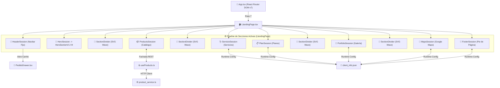
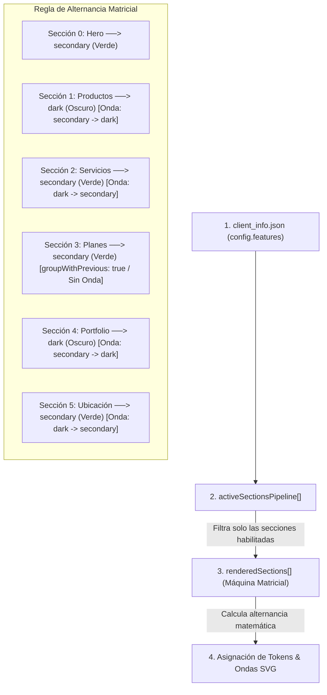

<!-- apps/web-client/src/pages/landing/README.md -->

# 🏠 Módulo Landing Page (`pages/landing`)

[⬅️ Volver a la Documentación Principal de Web Client](../../../README.md) | [🛒 Módulo de Pedidos y Carrito](../pedido/README.md) | [🏛️ Diagrama de Arquitectura](../../../docs/architecture/diagrama_arquitectura_fontend.md) | [📑 Overview de Arquitectura](../../../docs/architecture/overview.md)

---

## 📌 Visión General

La **Landing Page** es la vista principal orquestada por [`LlandingPage.tsx`](LlandingPage.tsx). Integra la propuesta de valor de la marca, la presentación institucional, el catálogo de productos interactivo conectado al carrito de compras, los servicios profesionales, las suscripciones/planes sanitarios, el portafolio de trabajos realizados y la localización física con mapa interactivo y canales directos de WhatsApp.

Opera bajo un **motor de alternancia matricial de fondos** y **divisores ondulatorios SVG dinámicos** ([`SectionDivider.tsx`](../../components/SectionDivider.tsx)), garantizando que los contrastes de color (`bg-vete-secondary` $\leftrightarrow$ `bg-vete-dark`) se calculen matemáticamente sin importar qué secciones se activen o apaguen en el archivo `config.json` del cliente.

---

## 📁 Estructura del Directorio (Navegable)

> 💡 **Tip:** Haz clic en cualquiera de los enlaces para abrir directamente el archivo en tu editor:

* 📁 **[pages/landing/](.)**
  * 📄 [LlandingPage.tsx](LlandingPage.tsx) *(Orquestador principal y motor matricial de secciones)*
  * 📄 [README.md](README.md) *(Este documento)*
  * 📁 **[sessions/](sessions/)**
    * 📄 [HederSession.tsx](sessions/HederSession.tsx) *(Barra de navegación fija superior con badge de carrito)*
    * 📄 [HeroSession.tsx](sessions/HeroSession.tsx) *(Despachador de portadas de impacto visual)*
    * 📁 **[HeroSection/](sessions/HeroSection/)** *(Estrategias de portada según ui_variants)*
      * 📄 [HeroSectionV1.tsx](sessions/HeroSection/HeroSectionV1.tsx) *(Portada clásica con imagen y titular destacado)*
      * 📄 [HeroSectionV2.tsx](sessions/HeroSection/HeroSectionV2.tsx) *(Portada minimalista con llamada de acción directa)*
      * 📄 [HeroSectionV3.tsx](sessions/HeroSection/HeroSectionV3.tsx) *(Variante moderna con acentos de color)*
      * 📄 [HeroSectionV4.tsx](sessions/HeroSection/HeroSectionV4.tsx) *(Variante multimedia con soporte animado)*
    * 📄 [ProductsSession.tsx](sessions/ProductsSession.tsx) *(Catálogo comercial con buscador y filtros de categoría)*
    * 📄 [ServicioSession.tsx](sessions/ServicioSession.tsx) *(Grilla de servicios profesionales y especialidades)*
    * 📄 [PlanSession.tsx](sessions/PlanSession.tsx) *(Planes de salud preventiva, suscripciones y paquetes)*
    * 📄 [PortfolioSession.tsx](sessions/PortfolioSession.tsx) *(Galería multimedia de trabajos realizados)*
    * 📄 [MapsSession.tsx](sessions/MapsSession.tsx) *(Ubicación geográfica, horarios y mapa embebido)*
    * 📄 [AboutSection.tsx](sessions/AboutSection.tsx) *(Bloque institucional: Misión, Visión y Valores)*
    * 📄 [FooterSession.tsx](sessions/FooterSession.tsx) *(Pie de página corporativo con enlaces y créditos)*

---

## 📐 Arquitectura de Componentes y Flujo de Secciones

---

## 🎨 Motor de Alternancia Matricial de Colores y Divisores

[`LlandingPage.tsx`](LlandingPage.tsx) no acopla los colores de fondo a nombres de sección fijos. Si un cliente apaga la sección de Productos (`has_products: false`), las secciones subsiguientes recalculan sus fondos automáticamente para evitar colisiones cromáticas:

### Reglas del Motor:
1. **Alternancia Automática:** Si la sección previa fue `secondary`, la siguiente adopta `dark`, y viceversa.
2. **Agrupamiento Semántico (`groupWithPrevious`):** La sección de Planes sanitarios (`PlanSession`) comparte el mismo fondo de Servicios (`ServicioSession`) si ambas están activas, suprimiendo el divisor SVG para crear una zona continua y cohesiva.
3. **Divisores Ondulatorios:** [`SectionDivider.tsx`](../../components/SectionDivider.tsx) recibe `topColor` (fondo anterior) y `bottomColor` (fondo nuevo), proyectando una onda SVG vectorial limpia.

---

## 🥞 Jerarquía de Capas de Apilamiento (Stacking Context & Z-Index)

Para garantizar que los videos 3D de fondo no tapen los textos, y que la barra flotante y el drawer se mantengan siempre accesibles, la Landing Page establece una jerarquía estricta de 6 niveles de `z-index`:

| Capa / Nivel | Componente | Responsabilidad |
| :--- | :--- | :--- |
| **`z-[160]` / `z-[150]`** | [`PedidoDrawer.tsx`](../pedido/PedidoDrawer.tsx) y Backdrop | Panel lateral de checkout y overlay oscuro de fondo. |
| **`z-[60]`** | [`HederSession.tsx`](sessions/HederSession.tsx) | Barra de navegación superior fija (`sticky top-0`). |
| **`z-[55]`** | [`FooterSession.tsx`](sessions/FooterSession.tsx) | Pie de página corporativo (cubre la barra flotante al hacer scroll completo). |
| **`z-[50]`** | [`FloatingBottomBar.tsx`](../../components/FloatingBottomBar.tsx) | Barra flotante inferior de accesos rápidos con auto-ocultado cerca del footer. |
| **`z-[45]`** | [`AmbientScrollAnimation.tsx`](../../components/animations/AmbientScrollAnimation.tsx) | Video volumétrico 3D WebM flotante con scroll interactivo. |
| **`z-20`** | Contenido Seccional | Textos, botones CTA, tarjetas de producto y carruseles. |
| **`z-0`** | Fondos y Divisores SVG | Contenedores estructurales y vectores ondulatorios de [`SectionDivider.tsx`](../../components/SectionDivider.tsx). |

---

## 🧩 Descripción Detallada de Módulos Seccionales

### 1. [`HederSession.tsx`](sessions/HederSession.tsx) (Cabecera y Navegación)
Barra de navegación fija (`sticky top-0 z-[60]`) adaptada a la marca del tenant:
* **Identidad Dinámica:** Isotipo vectorial y nombre comercial con isotipo del tenant.
* **Navegación Fluida:** Anclas suaves hacia `#HeroSession`, `#ProductsSession`, `#ServicioSession`, `#PlanSession`, `#PortfolioSession` y `#MapsSection`.
* **Badge de Carrito:** Muestra el total acumulado de unidades (`itemCount` de `usePedidoStore`) y abre el [`PedidoDrawer`](../pedido/PedidoDrawer.tsx).
* **Menú Móvil:** Desplegable responsive para dispositivos móviles con cierre táctil fuera del contenedor.

### 2. [`HeroSession.tsx`](sessions/HeroSession.tsx) (Portada Principal)
Despachador que lee `config.ui_variants.hero` e instancia la versión correspondiente ([`HeroSectionV1`](sessions/HeroSection/HeroSectionV1.tsx) a [`V4`](sessions/HeroSection/HeroSectionV4.tsx)):
* Titular dinámico con resaltado en eslogan (`prefix`, `highlight`, `suffix`).
* Banners gráficos montados desde `/tenant/hero.png` o animación Lottie `/tenant/animations/hero_animation.json`.
* Botón directo hacia el catálogo de productos o consulta por WhatsApp.

### 3. [`ProductsSession.tsx`](sessions/ProductsSession.tsx) (Catálogo Transaccional)
Módulo central de venta de productos:
* **Integración con Fachada:** Consume el hook [`useProducts.ts`](../../hooks/useProducts.ts).
* **Buscador en Memoria:** Búsqueda facetada instantánea por nombre, descripción y etiquetas de subcategoría.
* **Agrupación:** Renderiza tarjetas [`CategoryGroupCard.tsx`](../../components/CategoryGroupCard.tsx) que a su vez despachan tarjetas individuales [`ProductCard.tsx`](../../components/ProductCard/ProductCard.tsx) (`ProductCardV1` plana o `ProductCardV2` con acordeón).
* **Variantes y Stock:** Admite selección de talle/medida/color antes de añadir al carrito.

### 4. [`ServicioSession.tsx`](sessions/ServicioSession.tsx) (Servicios Profesionales)
Muestra la lista de especialidades de la empresa:
* Carga datos desde `config.services_section.items`.
* Renderiza tarjetas [`ServiceCard.tsx`](../../components/ServiceCard.tsx) con icono representativo, descripción técnica y botón de consulta directa por WhatsApp.

### 5. [`PlanSession.tsx`](sessions/PlanSession.tsx) (Programas de Salud y Suscripciones)
Presenta planes recurrentes o membresías:
* Carga datos desde `config.plans_section.items`.
* Renderiza tarjetas de precio [`PlanCard.tsx`](../../components/PlanCard.tsx) con lista de beneficios incluidos y llamada a la acción hacia WhatsApp.

### 6. [`PortfolioSession.tsx`](sessions/PortfolioSession.tsx) (Galería de Trabajos)
Galería fotográfica o de casos de éxito:
* Lee elementos de `config.portfolio_section.items`.
* Utiliza el despachador [`PortfolioCard.tsx`](../../components/PortfolioCard/PortfolioCard.tsx) con soporte para multimedia antes/después y etiquetas temáticas.

### 7. [`MapsSession.tsx`](sessions/MapsSession.tsx) (Ubicación y Horarios)
Mapa interactivo y ficha de contacto físico:
* Lee la dirección física, horarios de atención habituales, teléfonos de emergencia y la URL embebida de Google Maps desde `config.locations`.
* Tarjeta informativa responsive con enlace de navegación GPS para Waze o Google Maps.

### 8. [`AboutSection.tsx`](sessions/AboutSection.tsx) (Misión, Visión y Valores)
Bloque institucional que transmite la historia y principios del comercio:
* Disposición alternada de imágenes (`/tenant/mision.png`, `/tenant/vision.png`, `/tenant/valores.png`) y párrafos explicativos mediante el subcomponente `InfoSection`.

### 9. [`FooterSession.tsx`](sessions/FooterSession.tsx) (Pie de Página Corporativo)
Sección inferior (`z-[55]`):
* Canales de contacto directos, redes sociales corporativas (Instagram, Facebook), correo electrónico y aviso legal de derechos reservados por **NorthCode**.

---

## 🔗 Referencias Cruzadas y Enlaces de Interés

* 📘 [README Principal del Frontend Web Client](../../../README.md)
* 🛒 [Documentación del Módulo Pedidos y Carrito](../pedido/README.md)
* 🏛️ [Diagrama de Arquitectura Global](../../../docs/architecture/diagrama_arquitectura_fontend.md)
* 📑 [Overview de Arquitectura](../../../docs/architecture/overview.md)
* ⚛️ [Documentación Oficial de React 19](https://react.dev/)
* 🎨 [Documentación Oficial de Tailwind CSS](https://tailwindcss.com/)
