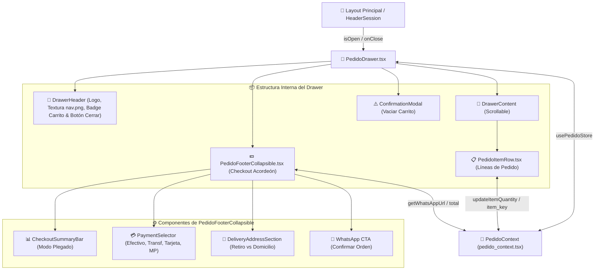

<!-- apps/web-client/src/pages/pedido/README.md -->

# 🛒 Módulo de Pedidos y Carrito de Compras (`pages/pedido`)

[⬅️ Volver a la Documentación Principal de Web Client](../../../README.md) | [🏠 Módulo Landing Page](../landing/README.md) | [🏛️ Diagrama de Arquitectura](../../../docs/architecture/diagrama_arquitectura_fontend.md) | [📑 Overview de Arquitectura](../../../docs/architecture/overview.md)

---

## 📌 Visión General

El módulo `pedido` gestiona la experiencia completa de checkout y carro de compras en la aplicación web mediante un panel lateral deslizable (Off-Canvas Drawer). Permite al visitante:

1. Seleccionar productos y variantes específicas (talles, presentaciones, medidas y colores).
2. Modificar cantidades numéricas manualmente o mediante botones rápidos `+` / `-`.
3. Seleccionar la modalidad de entrega (Retiro en Local vs Envío a Domicilio).
4. Elegir la forma de pago (Efectivo, Transferencia Bancaria con datos de cuenta automáticos, Tarjeta con POS o Mercado Pago).
5. Despachar la orden estructurada directamente al **WhatsApp oficial del comercio** sin necesidad de pasarelas de pago externas intermedias.
6. Compartir o reanudar carritos de compra mediante **Deep Linking** en la URL (`?cart=...`).

---

## 📁 Estructura del Directorio (Navegable)

> 💡 **Tip:** Haz clic en los enlaces para abrir directamente los componentes en tu editor:

* 📁 **[pages/pedido/](.)**
  * 📄 [PedidoDrawer.tsx](PedidoDrawer.tsx) *(Contenedor maestro lateral Off-Canvas, encabezado y modales)*
  * 📄 [PedidoItemRow.tsx](PedidoItemRow.tsx) *(Fila de producto con badge de variante y selector numérico editable)*
  * 📄 [PedidoFooterCollapsible.tsx](PedidoFooterCollapsible.tsx) *(Pie de checkout colapsable, medios de pago y despacho WPP)*
  * 📄 [README.md](README.md) *(Este documento técnico)*

---

## 📐 Arquitectura de Componentes



---

## 🛡️ Arquitectura Anti-NaN y Clave Compuesta (`item_key`)

Para garantizar que el carrito opere de forma inmutable, soporte productos simples y con múltiples combinaciones de variantes (por ejemplo, Talle "S" y Talle "XL" del mismo producto) y nunca muestre `NaN` en los totales:

### 1. Clave Compuesta Única (`item_key`)
Cada línea dentro de `pedido` se identifica mediante una clave determinista generada por `getPedidoItemKey`:
```typescript
export const getPedidoItemKey = (productId: number, variantId?: number | null): string => {
  return variantId ? `${productId}_${variantId}` : `${productId}_base`;
};
```
* **Producto Simple:** `item_key = "14_base"`
* **Producto con Variante:** `item_key = "14_2"` (Producto 14, Variante 2)

Esto permite que `addToPedido` incremente la cantidad de la variante exacta sin interferir con otras variantes del mismo producto padre.

### 2. Precios Finales Absolutos
Se desestimó el modelo de "precio base + adicional relativo" debido a inconsistencias cuando el precio base era nulo o no venía en el DTO. En la arquitectura actual:
* Las variantes portan su precio final de venta absoluto: `var_precio_venta`.
* El producto padre porta `prod_precio_venta`.
* Al agregarse a la canasta, el precio se congela en `precio_unitario_capturado`:
```typescript
const precioBase = Number(product.prod_precio_venta);
const precioVariante = variant ? Number(variant.var_precio_venta ?? precioBase) : precioBase;
const precioCapturado = isNaN(precioVariante) ? 0 : precioVariante;
```

### 3. Reductores de Total e Ítems Blindados
```typescript
const total = useMemo(() => {
  return pedido.reduce((acc, item) => {
    const precioUnitario = Number(item.precio_unitario_capturado) || 0;
    const cantidad = Number(item.cantidad) || 0;
    return acc + (precioUnitario * cantidad);
  }, 0);
}, [pedido]);
```

---

## 🧩 Descripción Detallada de Componentes

### 1. [`PedidoDrawer.tsx`](PedidoDrawer.tsx) (Orquestador Lateral)
Panel Off-Canvas anclado a la derecha de la pantalla:
* **Transiciones de Apertura:** Utiliza `translate-x-0` (visible) y `translate-x-full` (oculto) con duración de 500ms y fondo oscurecido (`backdrop-blur-sm`).
* **`DrawerHeader`:**
  * Muestra el isotipo del cliente y su nombre comercial con formato responsive.
  * Integra la textura corporativa de pasto invertido (`/tenant/nav.png`) con opacidad sutil mediante transformación CSS `scale-y-[-1]`.
  * Incorpora el badge circular verde con la cantidad de productos (`ShoppingCart`).
  * Botón circular con icono `<X />` accesible para cerrar la vista.
* **`DrawerContent`:**
  * Si el carrito está vacío, presenta una pantalla ilustrada con el icono `<Package />` y texto explicativo.
  * Si tiene productos, itera la lista despachando un [`PedidoItemRow`](PedidoItemRow.tsx) por cada `item_key`.
* **Modales:**
  * Integra [`ConfirmationModal.tsx`](../../components/ConfirmationModal.tsx) para prevenir el vaciado accidental del carrito.

### 2. [`PedidoItemRow.tsx`](PedidoItemRow.tsx) (Línea de Ítem Interactiva)
Representa cada producto o variante en el carrito:
* **Badge de Variante:** Si el producto incluye variante seleccionada (`variante_seleccionada`), muestra una etiqueta destacada con el tipo y valor (ej: `Talle: M` o `Volumen: 500ml`) y el color asociado si existe.
* **Control Numérico en Vivo:**
  * Permite tipear directamente la cantidad en un `<input inputMode="numeric">`.
  * Sanea la entrada en caliente mediante regex `value.replace(/[^0-9]/g, '')` para evitar letras o símbolos.
  * Valida en `onBlur` asegurando que la cantidad nunca sea menor a 1 ni quede en blanco.
* **Botones Rápidos:**
  * Botón `+`: Incrementa en 1 unidad.
  * Botón `-`: Decrementa en 1 unidad (si la cantidad es 1, activa el icono de papelera `<Trash2 />` para eliminar la línea).
* **Cálculo de Subtotal:** Muestra el subtotal calculado en tiempo real formateado en moneda uruguaya (`$XX.XXX`).

### 3. [`PedidoFooterCollapsible.tsx`](PedidoFooterCollapsible.tsx) (Checkout Colapsable)
Acordeón inteligente anclado a la base del panel (`sticky bottom-0`):

```text
┌─────────────────────────────────────────────────────────┐
│                 isExpanded = false / true               │ (Interruptor Acordeón)
└────────────────────────────┬────────────────────────────┘
             ┌───────────────┴───────────────┐
             ▼                               ▼
   ESTADO CERRADO (false)          ESTADO ABIERTO (true)
   ───────────────────────         ───────────────────────
   1. Muestra CheckoutSummaryBar   1. Muestra botón de plegado
      (💵 Método | 📍 Dirección)   2. Despliega sub-componentes:
   2. Mantiene footer compacto        • PaymentSelector
   3. Muestra Total y Botón WPP       • DeliveryAddressSection
```

* **Modalidades de Pago (`PAYMENT_METHOD_IDS`):**
  * `efectivo`: Instruye coordinar cambio con el repartidor.
  * `transferencia`: Inyecta automáticamente los números de cuenta bancaria del cliente configurados en `client_info.json` (ej: BROU, PREX, Santander) y solicita adjuntar el comprobante.
  * `tarjeta`: Solicita al comercio llevar terminal POS móvil.
  * `mercadopago`: Solicita el link de cobro o código QR digital.
* **Logística de Entrega:**
  * Switch entre *"Retiro en Local"* (muestra la dirección física del comercio y enlace a Google Maps) y *"Envío a Domicilio"* (habilita campo para ingresar calle y número).

---

## 📲 Generación del Payload de WhatsApp

Al hacer clic en *"Confirmar Pedido por WhatsApp"*, el método `getWhatsAppUrl` en [`pedido_context.tsx`](../../context/pedido_context.tsx) construye un mensaje con formato Markdown nativo de WhatsApp:

```text
🛒 *PEDIDO - VETERINARIA BELTRAMELLI*

📍 *Entrega:* Calle Uruguay 1234, Salto
----------------------------------
✅ 2x Royal Canin Maxi Adult (Presentación: 15 Kg) - $5.400
✅ 1x Collar Antipulgas Seresto (Talle: Grande) - $1.850
----------------------------------
💰 *TOTAL:* $7.250

_Forma de pago: Transferencia Bancaria_
*Datos de Transferencia:*
- *BROU:* N° 001234567-00001 (Valeria Beltramelli)
_Adjuntaré el comprobante por este medio._

_Enviado desde el portal web oficial_
```

El teléfono destino se limpia de caracteres no numéricos y se le antepone el código de país (por defecto `598` para Uruguay):
`https://wa.me/598XXXXXXXX?text=<mensaje_codificado>`

---

## 🔗 Deep Linking y Carrito Compartible en URL

* **Guardado en URL:** Cada vez que el usuario modifica el carrito, el hook [`useProducts.ts`](../../hooks/useProducts.ts) serializa las líneas:
  `window.history.replaceState({}, '', '?cart=14_1:2,20_base:1')`
* **Rehidratación:** Cuando otro usuario o el mismo cliente abre el enlace, la aplicación detecta el parámetro `cart`, mapea los identificadores contra el catálogo recién descargado del backend e invoca `loadPedidoMasivo`, restaurando el carrito idéntico en un solo paso.

---

## 🔗 Referencias Cruzadas y Enlaces Útiles

* 📘 [README General de apps/web-client](../../../README.md)
* 🏠 [Documentación de Landing Page](../landing/README.md)
* 🏛️ [Diagrama de Arquitectura de Capas](../../../docs/architecture/diagrama_arquitectura_fontend.md)
* 📑 [Overview de Arquitectura del Frontend](../../../docs/architecture/overview.md)
* 📱 [API de Enlaces Universales de WhatsApp](https://faq.whatsapp.com/5913398998672934)
