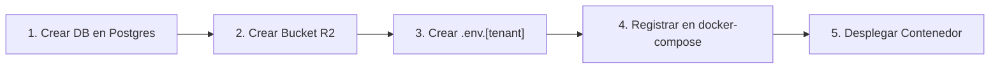

<!-- infrastructure/README.md -->

# 🌐 Infraestructura y Orquestación Multi-Tenant (NorthCode / VetCore)

> **Centro de Documentación de Infraestructura: Orquestación con Docker Compose V2, Redes Aisladas, Clúster de Base de Datos Multi-Tenant, Almacenamiento Distribuido Cloudflare R2 y Exposición Segura.**

VetCore implementa un modelo de infraestructura híbrido basado en los patrones **Container-per-Tenant** (aislamiento de proceso a nivel de aplicación) y **Database-per-Tenant** (aislamiento lógico de datos dentro de un clúster unificado de PostgreSQL). Toda la plataforma se comunica a través de una red virtual privada segura (`northcode-net`).

---

## 🏛️ Topología General del Sistema

A continuación se detalla la arquitectura completa de despliegue entre clientes, contenedores, persistencia y almacenamiento de objetos:

```mermaid
graph TD
    %% ==========================================
    %% CLIENTES Y FRONTENDS
    %% ==========================================
    subgraph layer_clients ["🌐 Frontends Web Multi-Tenant (React 19 + Nginx)"]
        F1["Frontend: Veterinaria Beltramelli<br/><code>veterinaria-beltramelli.com</code><br/>Puerto Host: <b>8081</b>"]
        F2["Frontend: Malandro Barber<br/><code>malandrobarber.northcode-uy.com</code><br/>Puerto Host: <b>8082</b> (Standalone)"]
        F3["Frontend: Vestimenta Flor de Loto<br/><code>flordeloto-moda.northcode-uy.com</code><br/>Puerto Host: <b>8083</b>"]
        FN["Frontend: Tenant N (Escalabilidad)<br/>Puerto Host: <b>808X</b>"]
    end

    %% ==========================================
    %% RED DOCKER PRIVADA
    %% ==========================================
    subgraph docker_network ["🐳 Red Privada Docker: northcode-net (Puente Externo)"]

        subgraph backend_containers ["🚀 Contenedores Backend FastAPI (Aislados por Tenant)"]
            BV["Contenedor: <code>backend_vet_beltramelli</code><br/>Puerto Host: <b>8001</b><br/>ENV: .env.veterinaria"]
            BF["Contenedor: <code>backend_vestimenta_flordeloto</code><br/>Puerto Host: <b>8002</b><br/>ENV: .env.flordeloto"]
            BN["Contenedor: <code>backend_tenant_n</code><br/>Puerto Host: <b>800X</b>"]
        end

        subgraph db_container ["🐘 Clúster PostgreSQL 15 - Contenedor: <code>vet_db_bel</code> (Puerto 5432)"]
            PG_ENGINE[("Motor PostgreSQL Engine")]

            subgraph isolated_databases ["Bases de Datos Aisladas"]
                DB1[("vet_beltramelli_db<br/>Usuario: <code>usr_veterinaria</code>")]
                DB2[("flor_de_loto_db<br/>Usuario: <code>usr_flordeloto</code>")]
                DBN[("tenant_n_db<br/>Usuario: <code>usr_tenant_n</code>")]
            end

            PG_ENGINE --- DB1
            PG_ENGINE --- DB2
            PG_ENGINE --- DBN
        end
    end

    %% ==========================================
    %% ALMACENAMIENTO R2
    %% ==========================================
    subgraph cloudflare_r2 ["☁️ Almacenamiento de Objetos: Cloudflare R2 (Cero Egress)"]
        R2_1[("Bucket: <code>vetcore-media</code><br/>media.veterinaria-beltramelli.com")]
        R2_2[("Bucket: <code>flordeloto-media</code><br/>media.flordeloto.com")]
        R2_N[("Bucket: <code>tenant-n-media</code>")]
    end

    %% ==========================================
    %% ACCESO REMOTO TEMPORAL
    %% ==========================================
    subgraph cloudflare_tunnels ["⚡ Túneles Cloudflare (Script: esponer_entorno_tem.sh)"]
        CFT["cloudflared tunnel<br/>Público: <code>*.trycloudflare.com</code>"]
    end

    CFT -.->|Exposición Móvil / Pruebas| F1
    CFT -.->|Exposición Móvil / Pruebas| BV

    F1 -->|HTTP Proxy / REST| BV
    F3 -->|HTTP Proxy / REST| BF
    FN -->|HTTP Proxy / REST| BN

    BV -->|Sesión Aislada| DB1
    BF -->|Sesión Aislada| DB2
    BN -->|Sesión Aislada| DBN

    BV -.->|S3 API Boto3| R2_1
    BF -.->|S3 API Boto3| R2_2
    BN -.->|S3 API Boto3| R2_N

    classDef clientStyle fill:#0f172a,stroke:#38bdf8,stroke-width:2px,color:#fff;
    classDef backendStyle fill:#1e293b,stroke:#3b82f6,stroke-width:2px,color:#fff;
    classDef dbStyle fill:#064e3b,stroke:#10b981,stroke-width:2px,color:#fff;
    classDef r2Style fill:#431407,stroke:#f97316,stroke-width:2px,color:#fff;
    classDef tunnelStyle fill:#581c87,stroke:#c084fc,stroke-width:2px,color:#fff;

    class F1,F2,F3,FN clientStyle;
    class BV,BF,BN backendStyle;
    class PG_ENGINE,DB1,DB2,DBN dbStyle;
    class R2_1,R2_2,R2_N r2Style;
    class CFT tunnelStyle;
```



> 📄 Diagrama independiente guardado en [diagrama_arquitectura.md](file:///home/ary/Documentos/proyect/app/vet-core/infrastructure/diagrama_arquitectura.md).

---

## 📑 Índice de Archivos de Infraestructura (Accesos Directos)

| Archivo / Recurso | Descripción y Responsabilidad |
| :--- | :--- |
| 📄 [docker-compose.yml](file:///home/ary/Documentos/proyect/app/vet-core/docker-compose.yml) | **Orquestador Raíz:** Importa los submódulos de Backend y Frontend mediante `include:` y declara la red externa `northcode-network`. |
| 📄 [api-backend/docker-compose.yml](file:///home/ary/Documentos/proyect/app/vet-core/api-backend/docker-compose.yml) | **Orquestador Backend & DB:** Declara el contenedor de base de datos PostgreSQL 15 (`vet_db_bel`) y los contenedores FastAPI por cliente. |
| 📄 [apps/web-client/docker-compose.yml](file:///home/ary/Documentos/proyect/app/vet-core/apps/web-client/docker-compose.yml) | **Orquestador Frontends:** Despliega las aplicaciones React bajo NGINX aplicando la arquitectura de volumen montado en caliente (Zero-Rebuild). |
| 📄 [api-backend/Dockerfile](file:///home/ary/Documentos/proyect/app/vet-core/api-backend/Dockerfile) | **Imagen Base del Backend:** Empaqueta FastAPI con Python y dependencias de producción. |
| 📄 [apps/web-client/dockerfile](file:///home/ary/Documentos/proyect/app/vet-core/apps/web-client/dockerfile) | **Imagen Base del Frontend:** Multi-stage build compilando Vite/React y sirviendo con NGINX Alpine. |
| 📄 [esponer_entorno_tem.sh](file:///home/ary/Documentos/proyect/app/vet-core/esponer_entorno_tem.sh) | **Túneles Cloudflare:** Script automatizado para publicar puertos locales a internet temporalmente para pruebas móviles. |
| 📄 [run.sh](file:///home/ary/Documentos/proyect/app/vet-core/run.sh) | **Runner Global:** Script de arranque rápido para Uvicorn en desarrollo local. |
| 📄 [api-backend/run_desarollo.py](file:///home/ary/Documentos/proyect/app/vet-core/api-backend/run_desarollo.py) | **CLI Multi-Tenant:** Levanta tenants locales con creación interactiva de base de datos y migración suave de columnas. |

---

## 🔌 Matriz de Puertos, Servicios y Clientes

| Tenant / Servicio | Contenedor Docker | Puerto Host | Puerto Contenedor | Red Docker | Base de Datos / Bucket |
| :--- | :--- | :---: | :---: | :--- | :--- |
| **PostgreSQL Clúster** | `vet_db_bel` | `5432` | `5432` | `northcode-net` | Host de todas las DBs lógicas |
| **Veterinaria Beltramelli (Backend)** | `backend_vet_beltramelli` | `8001` | `8001` | `northcode-net` | `vet_beltramelli_db` / `vetcore-media` |
| **Veterinaria Beltramelli (Frontend)** | `nc-web-valeria` | `8081` | `80` | `northcode-net` | Proxy a `backend_vet_beltramelli:8001` |
| **Flor de Loto (Backend)** | `backend_vestimenta_flordeloto` | `8002` | `8002` | `northcode-net` | `flor_de_loto_db` / `flordeloto-media` |
| **Flor de Loto (Frontend)** | `nc-web-flordeloto` | `8083` | `80` | `northcode-net` | Proxy a `backend_vestimenta_flordeloto:8002` |
| **Malandro Barber (Frontend)** | `nc-web-malandrobarber` | `8082` | `80` | `northcode-net` | Modo Standalone (Pedidos a WhatsApp) |

---

## 🛠️ Pilares de la Infraestructura Configurada

### 1. Red Compartida `northcode-net`
Todos los contenedores se comunican internamente por nombre de servicio gracias al DNS integrado de Docker. La red se declara como externa:
```bash
# Crear la red externa una única vez en el host si no existe:
docker network create northcode-net
```

### 2. Patrón "Zero-Rebuild" para Frontends Web
La aplicación React 19 ([apps/web-client](file:///home/ary/Documentos/proyect/app/vet-core/apps/web-client/README.md)) se compila una sola vez en la imagen inmutable `vetcore-web-client:latest`. Cada comercio inyecta en caliente sus archivos de personalización:
- **Identidad comercial y temas:** `config.json` montado en `/usr/share/nginx/html/config/client_info.json:ro`.
- **Multimedia y logotipos:** Carpeta `assets/` montada en `/usr/share/nginx/html/tenant:ro`.

### 3. Aislamiento Fuerte de Datos (Database-per-Tenant)
Cada cliente posee un usuario con contraseña propia y una base de datos física dedicada (`vet_beltramelli_db`, `flor_de_loto_db`). De este modo, un tenant no tiene permisos de lectura ni escritura sobre los esquemas de otros comercios.

### 4. Almacenamiento Distribuido Cloudflare R2
- **Desacoplamiento:** Los contenedores backend no guardan imágenes en el almacenamiento local en producción.
- **Protocolo:** Utiliza el API compatible con S3 de AWS mediante `boto3`.
- **Costos:** Egress (salida de ancho de banda) 100% gratuito hacia internet y CDN.

### 5. Exposición Rápida para Pruebas con `cloudflared`
Mediante el script [esponer_entorno_tem.sh](file:///home/ary/Documentos/proyect/app/vet-core/esponer_entorno_tem.sh):
1. Detecta automáticamente los puertos configurados en los `.env`.
2. Lanza túneles seguros temporales hacia `https://*.trycloudflare.com`.
3. Permite auditar el comportamiento en dispositivos móviles reales (cámara para escaneo QR, flujo de pedidos por WhatsApp, layouts responsive) sin abrir puertos de red.

---

## 🚀 SOP: Aprovisionamiento de un Nuevo Tenant (Paso a Paso)

Cuando entra un nuevo comercio a la plataforma, se ejecuta el siguiente procedimiento:



### Paso 1: Crear la Base de Datos en PostgreSQL
```bash
docker exec -it vet_db_bel psql -U ary -c "CREATE USER usr_[TENANT_ID] WITH PASSWORD 'clave_segura_aqui';"
docker exec -it vet_db_bel psql -U ary -c "CREATE DATABASE [TENANT_ID]_db OWNER usr_[TENANT_ID];"
docker exec -it vet_db_bel psql -U ary -c "GRANT ALL PRIVILEGES ON DATABASE [TENANT_ID]_db TO usr_[TENANT_ID];"
```

### Paso 2: Crear el Bucket en Cloudflare R2
1. Ingresar al panel de **Cloudflare > R2 > Create bucket** con el nombre `[TENANT_ID]-media`.
2. Habilitar dominio público o subdominio `r2.dev`.
3. Crear un **API Token** con permisos `Object Read & Write` restringido a ese bucket y anotar las credenciales.

### Paso 3: Configurar el Archivo `.env.[TENANT_ID]`
Crear [api-backend/.env.[TENANT_ID]](file:///home/ary/Documentos/proyect/app/vet-core/api-backend/.env.example) con:
```env
ENV_MODE=production
IS_DOCKER=true
DB_USER=usr_[TENANT_ID]
DB_PASSWORD=clave_segura_aqui
DB_NAME=[TENANT_ID]_db
DB_HOST=vet_db_bel
DB_PORT=5432
APP_PORT=800X
BASE_URL=https://api.[TENANT_DOMINIO].com
ALLOWED_ORIGINS=https://[TENANT_DOMINIO].com
TENANT_TYPE=RETAIL  # VET | RETAIL | SERVICES
ENABLE_AGENDA=false
SECRET_KEY=clave_secreta_jwt_de_32_bytes_minimo
R2_ACCOUNT_ID=tu_account_id
R2_ACCESS_KEY_ID=tu_access_key
R2_SECRET_ACCESS_KEY=tu_secret_key
R2_BUCKET_NAME=[TENANT_ID]-media
R2_PUBLIC_URL=https://media.[TENANT_DOMINIO].com
```

### Paso 4: Declarar el Servicio en `api-backend/docker-compose.yml`
```yaml
  backend-[TENANT_ID]:
    build: .
    container_name: backend_[TENANT_ID]
    restart: always
    ports:
      - "800X:800X"
    env_file:
      - .env.[TENANT_ID]
    networks:
      - northcode-net
```

### Paso 5: Despliegue en Vivo sin Afectar a Clientes Existentes
```bash
docker compose up -d --build backend-[TENANT_ID]
```

---

## 💾 SOP: Protocolo de Copias de Seguridad y Desvinculación (Handover)

### Respaldo de Base de Datos
```bash
# Dump binario comprimido
docker exec -t vet_db_bel pg_dump -U ary -d [TENANT_ID]_db -F c -b -v -f /tmp/backup.bin
docker cp vet_db_bel:/tmp/backup.bin ./backup.bin
docker exec -it vet_db_bel rm /tmp/backup.bin

# Dump SQL plano editable
docker exec -t vet_db_bel pg_dump -U ary -d [TENANT_ID]_db --clean --if-exists --no-owner --no-privileges > ./backup.sql
```

### Descarga de Multimedia (Cloudflare R2 con AWS CLI)
```bash
aws s3 sync s3://[TENANT_ID]-media ./media_backup \
  --endpoint-url https://[R2_ACCOUNT_ID].r2.cloudflarestorage.com \
  --profile export-[TENANT_ID]
```
