<!-- infrastructure/diagrama_arquitectura.md -->

# 🏛️ Topología de Infraestructura Multi-Tenant (VetCore / NorthCode)

Este diagrama representa la topología completa de red, el aislamiento de contenedores por tenant, la persistencia en el clúster unificado de PostgreSQL y el desacoplamiento de activos multimedia en Cloudflare R2.

```mermaid
graph TD
    %% ==========================================
    %% CAPA: CLIENTES Y FRONTENDS
    %% ==========================================
    subgraph layer_clients ["🌐 Capa de Clientes / Frontends Web (React 19 + Nginx)"]
        F1["Frontend: Veterinaria Beltramelli<br/><code>veterinaria-beltramelli.com</code><br/>Puerto Host: 8081"]
        F2["Frontend: Malandro Barber<br/><code>malandrobarber.northcode-uy.com</code><br/>Puerto Host: 8082"]
        F3["Frontend: Vestimenta Flor de Loto<br/><code>flordeloto-moda.northcode-uy.com</code><br/>Puerto Host: 8083"]
        FN["Frontend: Tenant N (Escalabilidad)<br/><code>cliente-n.com</code><br/>Puerto Host: 808X"]
    end

    %% ==========================================
    %% CAPA: DOCKER NETWORK (AISLAMIENTO PRIVADO)
    %% ==========================================
    subgraph docker_network ["🐳 Red Privada Docker: northcode-net"]

        %% Contenedores Backend Independientes
        subgraph backend_containers ["🚀 Contenedores Backend - FastAPI (Container-per-Tenant)"]
            BV["Container: backend_vet_beltramelli<br/><b>Puerto Host: 8001</b><br/>TENANT_TYPE=VET | AGENDA=true"]
            BF["Container: backend_vestimenta_flordeloto<br/><b>Puerto Host: 8002</b><br/>TENANT_TYPE=RETAIL | AGENDA=false"]
            BN["Container: backend_tenant_n<br/><b>Puerto Host: 800X</b><br/>Configuracion Dinamica"]
        end

        %% Contenedor Unico de Base de Datos
        subgraph db_container ["🐘 Clúster PostgreSQL 15 - vet_db_bel:5432"]
            PG_ENGINE[("Motor PostgreSQL Server")]

            subgraph isolated_databases ["Bases de Datos Lógicas Aisladas"]
                DB1[("vet_beltramelli_db<br/>Dueño: usr_veterinaria")]
                DB2[("flor_de_loto_db<br/>Dueño: usr_flordeloto")]
                DBN[("tenant_n_db<br/>Dueño: usr_tenant_n")]
            end

            PG_ENGINE --- DB1
            PG_ENGINE --- DB2
            PG_ENGINE --- DBN
        end
    end

    %% ==========================================
    %% CAPA: ALMACENAMIENTO DE OBJETOS EXTERNO
    %% ==========================================
    subgraph cloudflare_r2 ["☁️ Almacenamiento de Objetos: Cloudflare R2 - Stateless"]
        R2_1[("Bucket: vetcore-media<br/>media.veterinaria-beltramelli.com")]
        R2_2[("Bucket: flordeloto-media<br/>media.flordeloto.com")]
        R2_N[("Bucket: tenant-n-media<br/>media.tenant-n.com")]
    end

    %% ==========================================
    %% CAPA: ACCESO EXTERNO / TÚNELES CLOUDFLARE
    %% ==========================================
    subgraph cloudflare_tunnels ["⚡ Cloudflare Tunnels (Entorno Temporal / Celular)"]
        CFT["cloudflared tunnel<br/>URL Dinámica: *.trycloudflare.com"]
    end

    %% ==========================================
    %% FLUJO DE CONEXIONES Y DEPENDENCIAS
    %% ==========================================
    CFT -.->|Exposición Temporal| F1
    CFT -.->|Exposición Temporal| BV

    F1 -->|HTTP Proxy / REST| BV
    F3 -->|HTTP Proxy / REST| BF
    FN -->|HTTP Proxy / REST| BN

    BV -->|Conexión Aislada| DB1
    BF -->|Conexión Aislada| DB2
    BN -->|Conexión Aislada| DBN

    BV -.->|S3 API Boto3| R2_1
    BF -.->|S3 API Boto3| R2_2
    BN -.->|S3 API Boto3| R2_N

    %% ==========================================
    %% ESTILOS VISUALES
    %% ==========================================
    classDef clientStyle fill:#0f172a,stroke:#38bdf8,stroke-width:2px,color:#fff;
    classDef backendStyle fill:#1e293b,stroke:#3b82f6,stroke-width:2px,color:#fff;
    classDef dbStyle fill:#064e3b,stroke:#10b981,stroke-width:2px,color:#fff;
    classDef r2Style fill:#431407,stroke:#f97316,stroke-width:2px,color:#fff;
    classDef tunnelStyle fill:#581c87,stroke:#c084fc,stroke-width:2px,color:#fff;

    class F1,F2,F3,FN clientStyle;
    class BV,BF,BN backendStyle;
    class PG_ENGINE,DB1,DB2,DBN dbStyle;
    class R2_1,R2_2,R2_N r2Style;
    class CFT tunnelStyle;
```

---

## 🔗 Accesos Directos a Archivos de Configuración

| Nodo del Diagrama | Recurso Asociado | Archivo de Configuración |
| :--- | :--- | :--- |
| **Orquestador Raíz** | Inclusión de servicios multi-capa | [docker-compose.yml](file:///home/ary/Documentos/proyect/app/vet-core/docker-compose.yml) |
| **Red Privada Docker** | `northcode-net` puente externo | [docker-compose.yml](file:///home/ary/Documentos/proyect/app/vet-core/docker-compose.yml#L11-L13) |
| **FastAPI Backends** | Orquestación de contenedores backend | [api-backend/docker-compose.yml](file:///home/ary/Documentos/proyect/app/vet-core/api-backend/docker-compose.yml) |
| **PostgreSQL Clúster** | Servicio `db-vet_bel` y volumen | [api-backend/docker-compose.yml](file:///home/ary/Documentos/proyect/app/vet-core/api-backend/docker-compose.yml#L7-L24) |
| **Tenant Veterinaria** | Env vars y configuración | [.env.veterinaria](file:///home/ary/Documentos/proyect/app/vet-core/api-backend/.env.veterinaria) |
| **Tenant Flor de Loto** | Env vars y configuración | [.env.flordeloto](file:///home/ary/Documentos/proyect/app/vet-core/api-backend/.env.flordeloto) |
| **Frontends Web** | Orquestador multi-tenant Nginx | [apps/web-client/docker-compose.yml](file:///home/ary/Documentos/proyect/app/vet-core/apps/web-client/docker-compose.yml) |
| **Túneles Cloudflare** | Script de exposición remota | [esponer_entorno_tem.sh](file:///home/ary/Documentos/proyect/app/vet-core/esponer_entorno_tem.sh) |
